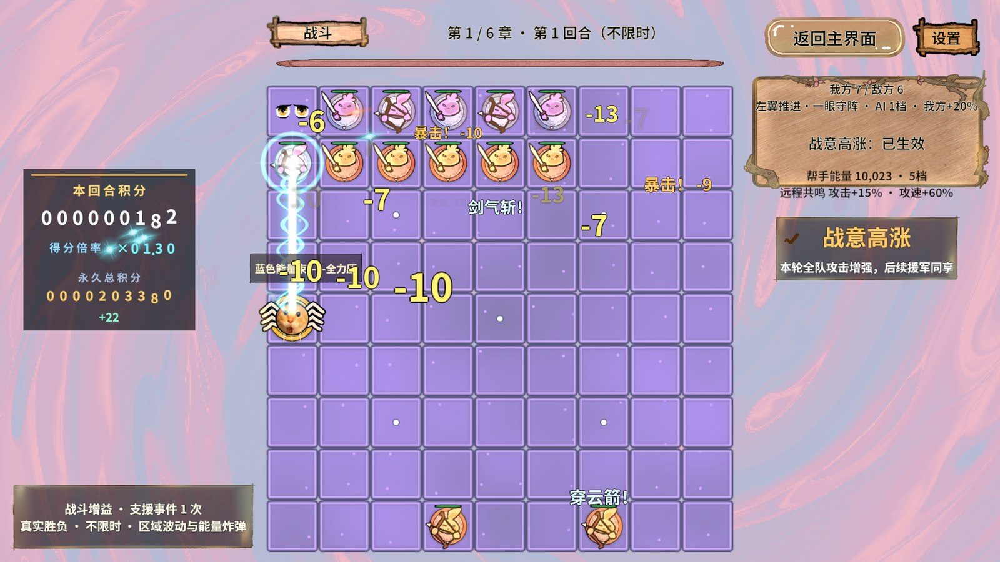

# RevGame · 围棋史莱姆

**在 9×9 棋盘上布置史莱姆军团，用连结、做眼、封气与换位迎战六章 Boss，再用战斗积分驱动助阵帮手与远程弹幕成长。**

RevGame 是基于 **Unity 2022.3.15f1c1 + Revolution** 的 2D 自动战斗游戏。玩家扮演误入史莱姆世界的冒险家，跟随向导团团找回六页棋谱，在围棋与魔法战斗交织的旅途中寻找回家的路。

这个项目首先是 **Revolution 框架的真实业务验证工程**：通过完整游戏流程、状态机、UI、资源加载、对象池、配置导表和自动化测试，发现框架在实际开发中的能力与边界。游戏体验与持续迭代也是项目的一部分，但框架可行性结论是第一交付物。

**当前状态：六章单机原型的主要玩法与表现系统已接通，正在持续调整数值、体验与资源体积；尚未完成正式发行和 Android 真机验收。**

> 本文按 **2026-10-28** 已提交实现更新。策划案及早期测试报告保留了一些旧设定；当前章回、伤害、成长与资源行为以代码、导表配置和对应版本的验证记录为准。

[玩法策划案](RevGame_Client/策划案/玩法拓展策划案.html) · [最新实现与测试报告](RevGame_Client/文档/进度同步/助阵帮手与棋盘管理-2026-10-28/助阵帮手与棋盘管理测试记录_2026-10-28.html) · [Revolution 框架](https://github.com/Yokino337088/Revolution) · [协作规范](AGENTS.md)

## 游戏怎么玩

### 一局的基本流程

```text
首次开场剧情 → 真实棋盘新手教学
                     ↓
首页 → 选章节 → 准备布阵 → 自动战斗 → 结算 → 下一回合
                     ↑                         ↓
                     └──── 章内保留存活残局 ─────┘

第 10 回合：Boss 入场 → 战斗 → 击败演出 → 章节剧情 → 奖励 / 后续章节
```

| 项目 | 当前实现 |
|---|---|
| 棋盘 | 9×9，共 81 格；棋子可能占用完整的多格身体 |
| 关卡 | 6 章，每章 **9 个普通回合 + 第 10 回合 Boss**，共 60 个章回 |
| 手牌 | 准备阶段六张手牌，每回合最多主动落六张；可以刷新剩余手牌，刷新不补落牌额度 |
| 战斗 | 棋子自动移动和攻击；普通回合与 Boss 回合均不限时 |
| 微操 | 点击己方棋子，再点空格换位；点击移除按钮主动腾位；点击敌棋指定帮手目标 |
| 章内继承 | 保留存活棋子的布局、生命与成长，回合增益和冷却按各自生命周期重置 |
| 换章 / 重开 | 重新布阵；本章成绩与帮手可用能源归零，历史累计成绩保留 |
| 胜负 | 敌方全灭，或满足条件擒王则胜；玩家棋子全灭则负，无敌帮手不会代替玩家存活 |

准备阶段先看到敌人的阵型，再决定前排、远程和连结位置。战斗阶段通常可以看棋子自动交战，也可以主动换位救援，或指定助阵帮手压制关键敌人。

最后一个普通回合，即第 9 回合，未落牌时可选择跳过，直接进入 Boss 回合并换取战役攻击加成。已经落牌或进入 Boss 回合后不能领取这项跳过收益。

### 围棋规则如何进入战斗

游戏借用了围棋的 **连、断、围、眼**，同时保留棋子的生命和实时攻击，因此并不是标准围棋对局。

- **连结**：相邻同伴形成棋群，共享阵型的气与眼；连通和职业组合也会影响战斗收益。
- **封气**：堵住相邻空位可造成围困，但零气不会立即提子。当前被锁死的敌棋不能移动或攻击，玩家零气棋仍可反击；围困会提高承伤风险。
- **做眼**：保留受保护的空点，支撑阵型与驻眼增益；驻眼、邻格治疗、远程补弩和有限复活由真实气眼规则驱动。
- **换位与取舍**：保护受伤后排，寻找断点，或主动移除棋子腾出空间。移除不返手牌，也不给击杀积分。

玩家远程棋子全盘搜敌；近战优先攻击接触目标，无接触目标时仍可援击远处敌人。敌方保留不同射界：重弩全盘压制，弓手直线射击，法师使用炮架规则。自动移动会考虑接敌、后撤和阵型安全。

**Boss 擒王条件更严格：主将生命降至 20% 或以下，同时封尽它的气，才可以擒王获胜。** 直接打掉 Boss 生命也能获胜，不能只靠围住满血 Boss 结束战斗。

### 棋子与成长

目前有 **9 种基础棋子、4 个职业、3 档星级**，不同外形具有不同基础血攻和走法。

| 棋子 | 职业 | 战斗定位 |
|---|---|---|
| 剑士 | 刺客 | 基础近战与接敌 |
| 盾战 | 守卫 | 承伤与保护阵型 |
| 重剑 | 守卫 | 近战输出 |
| 弓箭手 | 游侠 | 远程弹幕 |
| 重弩 | 游侠 | 全盘压制与驻眼支援 |
| 水法师 | 法师 | 魔法远程 |
| 火法师 | 法师 | 魔法输出 |
| 牧师 | 法师 | 特殊远程棋种 |
| 刺客 | 刺客 | 马步走法与突入 |

同类手牌成功落子会累计成长进度，当前每打出 **3 张同类牌**，培养一颗已有、未满星的同类棋子升一星。**新落棋子继续留在棋盘上，成长不会吞掉三颗棋子。** 星级血攻倍率、职业加成、章节奖励与战斗增益都通过配置表读取。

战斗有准备增益、周期事件、区域波动、全场能量炸弹“能量巨大”和有限应急治疗。它们帮助玩家缩短僵持或挽救失误，但不会强制删除残敌或把全灭改判为胜利。

## 助阵帮手与弹幕滚雪球

助阵帮手是独立的战斗演员，由 Revolution 重量级状态机管理充能、爬行、弹幕、持续激光和停战。

- **无敌、非占格**：敌方攻击无法选中它，不占棋格、不堵气，也不计入玩家存活数量。
- **智能支援**：优先 Boss，其次玩家指定目标，再压制敌方远程；棋盘拥挤时移动到右侧盘外空区继续攻击。
- **积分驱动**：玩家真实攻击、暴击与击杀是主要积分来源，积分飞向面板，再流向帮手；开火消耗本章可用能源，历史累计成绩不被扣减。
- **逐步成长**：本章每积累 8,000 分提高一档，最多 5 档，提升帮手伤害、频率与弹幕数量；24,000 分解锁持续蓝色能量束。
- **远程共鸣**：帮手越强，玩家远程的普攻和攻速同步成长；当前最高 **额外 +15% 攻击、+60% 攻速**。余额消费不降低成长档位，重新挑战或换章清零。
- **明确反馈**：四帧身体动画、可调金色反光 Shader、实时台词框、六章独立菱形魔法弹与粗大白蓝激光，命中端有冲击环和流动电弧。

帮手命中返分低于攻击消耗，激光持续扣能且不返分，避免无限自给自足。数量与火力控制也已加入：

| 限制 | 当前行为 |
|---|---|
| 玩家远程上限 | 最多 30 枚存活远程；手牌、援军与补子入口统一检查，拒绝不扣牌 |
| Boss 回合玩家棋数 | 超过 45 枚时吞噬多余数量，优先低星、同星优先近战；完整敌阵预检成功才提交 |
| 拥挤阵容火力 | 较大阵容的单位普攻收益递减，保留占格与承伤价值，控制瞬间清场 |
| 表现预算 | 弹道、飘字与帮手特效有独立对象池预算；视觉合并不改变实际伤害和积分 |

这些是当前配置值，可以继续通过 Excel 和材质调整。



## 六章内容与 Boss 演出

六章都有各自背景图片、背景材质、背景 Shader、棋盘格子动态效果和章节音乐。当前视觉顺序如下：

| 章节 | 场景与棋盘风格 | Boss 外观 | 专属退场效果 |
|---|---|---|---|
| 第一章 | 星落棋坪：星辰流动、柔和魔法光 | 剑士 | 星尘消解 |
| 第二章 | 魔法村落：明朗阳光与幻彩 | 弓手 | 阳光普照 |
| 第三章 | 镜湖：轻微水面波动与反射 | 水法师 | 水流吞噬 |
| 第四章 | 死亡沼泽：棕色黏稠流动 | 刺客 | 沼泽吞噬 |
| 第五章 | 冰雪极地：冰封、飘雪与清冷光 | 盾卫 | 逐渐冰封 |
| 第六章 | 魔法神殿：神圣光与迷幻魔纹 | 牧师 | 十字神罚 |

表中 Boss 是章节美术外观；战斗棋种、星级和占格另由 `ChapterConfig` 配置，二者不应混为一项。

Boss 技能已扩展到 **18 种**，按章节和配置权重逐步开放：横扫、狙击、轰炸、环形弹幕、瞬移爆破、旋转激光、汲取、召唤、狂暴，以及流星、十字激光、冰环、连锁雷电、毒沼、火墙、冰刺、引力场和末日符文。技能带预警、命中和应对提示。

进入 Boss 回合时，准备面板暂时隐藏，镜头给到主将特写，逆向播放章节显现效果，再配合登场弹幕和棋盘舞动恢复操作。击败后播放轻度慢动作、章节死亡效果、棋盘波浪、击败与章节总分弹幕，再进入收尾剧情。演出通过 `RevSequence` 编排，取消与退出都有清理步骤。

剧情使用 **ScriptableObject** 配置，包含首次开场、教学引子、章节开始、Boss 收尾与结局；对话采用下方居中的原项目 UI、史莱姆向导动画、DOTween 打字机和音效。新手教学发生在 **真实 GameScene、真实棋盘、真实手牌与战斗面板** 中，UI 只负责提示和高亮。

## 目前做到了哪里

| 模块 | 已完成内容 | 当前边界 |
|---|---|---|
| 单机流程 | 首页、选关、跨场景战斗、准备、结算、奖励、剧情和返回首页 | 仍在迭代体验与异常路径 |
| 棋盘战斗 | 占格、连通、气眼、围困、升星、职业收益、真实死亡移除、手动换位与移除 | 部分源码注释和旧策划条目仍需持续同步 |
| 玩家 / 敌方 AI | 近战接敌、远程后撤、敌方远程优先、阵型与增援、Boss 技能状态 | 启发式战术，仍需更多种子与真实玩家体验验证 |
| 助阵系统 | 无敌帮手、积分消耗、优先目标、盘外支援、菱形弹幕、蓝束与远程共鸣 | 后期节奏和爽感继续调优 |
| 表现与音频 | 六章背景与棋盘 Shader、Boss 八帧外观、登退场演出、弹幕、六章 BGM、玩家音量设置 | 高分辨率细节受源图精度限制，素材许可需按用途核对 |
| 资源控制 | Sprite Atlas V2 唯一归属、按寿命与章节分包、字体子集、纹理 / 音频压缩、PC / Android AB | **20～30 MB APK、六章离线**仍是目标，尚未完成 APK 体积验收 |
| 开发与测试 | RevCLI、RevMCP、开发态 GM、真实指针输入、规则断言、截图 / GIF / HTML 报告 | 自动化成功响应必须结合业务断言，不代表全部玩法通过 |
| 联机 / 服务端 | Fantasy 环境与框架接入，保留服务端工程与相关入口 | 游戏联机业务尚未完成，不宣称已有可用 PvP |
| 平台交付 | Windows Editor 与真实 PC AB 测试，Android AB 构建 | Android 真机性能、热稳定、最终安装包及其它平台未完整验收 |

## 最新验证结果

下列结果来自 **2026-10-28** 对应版本，完整证据见 [助阵帮手与棋盘管理最终报告](RevGame_Client/文档/进度同步/助阵帮手与棋盘管理-2026-10-28/助阵帮手与棋盘管理测试记录_2026-10-28.html)。本次 README 重写未重新运行这些游戏测试。

| 验证 | 已记录结果 | 应如何理解 |
|---|---|---|
| 棋盘管理 / 帮手 / 共鸣规则 | **41 条断言通过** | 复用真实服务、伤害、占格与 FSM，包含失败边界 |
| 真实 PC AB 视觉与操作 | **278 条断言通过，新增 Unity 错误 0** | 含逐帧图集检查、六章效果、真实 UI 输入与回收；不等于 278 个独立场景 |
| 三种子服务回放 | **180 胜 / 0 负**，战斗中位 **12.5 模拟秒** | 固定策略算法、真实战斗服务；没有图形或真机性能结论 |
| 完整六章实战覆盖 | **58 胜 / 2 负**，中位 **15.16 模拟秒**，玩家死亡 **63 枚** | 60 个章回，实际手牌输入和正常策略；第六章前两回合真实失败 |
| 实战作业日志 | **1 次自动化桥接文件共享冲突** | 作业完成了 60 回合，但不能报告整场零错误 |
| PC / Android 资源构建 | 各 **50 个 AB 包**；**14 张图集、248 张图片唯一覆盖** | 重复依赖、循环、漏标、重名和 Android Shader 门禁通过；六章背景包互不依赖 |

当前数值方向是：**合理布阵应稳定取胜，明显失误仍可失败，同时提供有限支援。** 测试胜率表明原型已具有可玩流程，也暴露了部分困难开局和短局；不能承诺任意策略保胜。

旧测试报告中的 11 回合、临时高倍率强化、60/60 胜利或旧性能数字属于当时版本。旧完整控制台套件还有两眼造局夹具失败，应独立处理；不能用本次 41 条断言替代整套旧回归。

## 运行项目

### 环境

- Unity **2022.3.15f1c1**；工程目录：`RevGame_Client/UnityProject/RevGame.Unity`。
- 当前使用 Built-in 2D 渲染、uGUI / TextMeshPro、DOTween 表现层与 Revolution。
- Git：Unity Package Manager 中存在 Git 包依赖。
- Python **3.10+**：RevCLI / RevMCP；独立战斗回归工程目标为 **.NET 10**。
- 客户端运行不要求启动 Fantasy 服务端，服务端接入情况见 [服务端 README](RevGame_Server/README.md)。

### 启动

```bash
git clone https://github.com/Yokino337088/RevGame.git
```

1. 使用指定 Unity 版本打开 `RevGame_Client/UnityProject/RevGame.Unity`，等待包解析和脚本编译完成。
2. 打开正式入口 **`Assets/Scenes/StartScene.unity`** 并进入 Play。
3. 首次进入会播放开场与简短教学；从首页进入选关，战斗由 GameFlow 异步交接到 GameScene。

过场在背景、81 格、棋子、手牌、UI 和必要资源全部可画后撤除。`EnterBattle` / `ReturnHome` 返回接受请求时，仍需等待 `IsTransitioning=false` 并核对实际 Screen。

编辑器直读资源与真实 AB 加载是两种验证模式。测试首次白图、图集绑定和资源释放时，应使用 **PC AB 冷启动**，不能预热全部图集后当作首次加载成功。

## 开发与自动化入口

从仓库根目录执行；编辑器操作复用已打开工程的 live 通道。

```powershell
$gameProject = "RevGame_Client/UnityProject/RevGame.Unity"
$revCli = "RevGame_Client/UnityProject/Revolution.RevCLI/rev.py"

python $revCli --project $gameProject doctor
python $revCli --project $gameProject --mode live commands --live
python $revCli --project $gameProject --mode live call editor.status

# 编辑态规则检查
python $revCli --project $gameProject --mode live call game.helper.rules

# 项目资源入口：包含导入、图集、依赖和Shader门禁
python $revCli --project $gameProject --mode live call game.background.build --set 'target="PC"'
```

开发态 GM 示例：

```text
RevGame/新手教学
RevGame/播放初始剧情
RevGame/解锁六章关卡
RevGame/进入Boss关卡 3
RevGame/Boss关卡就绪 3
RevGame/帮手状态
RevGame/帮手目标 456
RevGame/移除棋子 123
```

123 / 456 是语法示例，实际编号从当前棋盘查询。GM 受阶段和参数校验限制，进入或重播请求可能异步完成；每次连接、编译或域重载后重新发现实际注册能力。关键变更入口只在 Editor / Development Build 中提供。

当前独立规则回归可运行：

```powershell
dotnet run --project RevGame_Client/Tests/CombatAttackRegression/CombatAttackRegression.csproj -- RevGame_Client/UnityProject/RevGame.Unity/Assets/GameRes/Data helper
```

六章策略、六章视觉分别由 `game.balance.begin` 与 `game.helper.play` 驱动，结果查询为 `game.balance.state` 与 `game.helper.state`。这些长流程需按工具说明进入隔离 Play、保留失败证据，并在 finally 清理输入、计时器、临时存档与场景。历史计划可能仍带旧回合结构或高倍率强化，不能直接用来证明当前普通难度。

[RevCLI 使用说明](RevGame_Client/UnityProject/Revolution.RevCLI/README.md) · [RevMCP 使用说明](RevGame_Client/UnityProject/Revolution.RevMCP/README.md) · [Boss 直达 GM](RevGame_Client/文档/进度同步/六章Boss关卡GM说明-2026-10-27.md)

## 框架能力落在什么业务中

| Revolution 能力 | 当前业务落点 |
|---|---|
| `RevInitialize` / `RevServices` | 常驻 Bootstrap 一次初始化，注册流程、战斗、资源与存储服务 |
| `RevLightFSM` / `RevScope` / `RevLogic` | 首页、选关、战斗、结算、退出的流程与生命周期 |
| `RevHeavyFSM` | 玩家、敌方、Boss 与助阵帮手的状态管理 |
| `RevUI` / `RevUIPanel` / `RevUIPart` | 准备、HUD、剧情、教学浮层、设置、结算与奖励 |
| `RevTask` / `RevScene` | 场景交割、资源等待、取消与失败回退 |
| `RevTimer` / `RevEvent` | 固定步战斗、冷却、规则事实、积分和表现通知 |
| `RevPool` | 棋子、格子、弹道、飘字、积分粒子与短时特效 |
| `RevResManager` | 逻辑路径加载、图集租约、资源引用计数和分组释放 |
| `RevSequence` | Boss 登退场、特写、棋盘动画、弹幕与剧情的串联演出 |
| `RevSound` | 章节 BGM、打字机、战斗和 Boss 音效 |
| `RevDataTableManager` / Excel 工具 | 数值源表 → 生成数据 / 类型 → 启动校验 → 强类型读取 |
| `RevGM` / RevCLI / RevMCP | 玩家共用操作、只读查询、故障与隔离自动化验证 |

**当前可行性结论**：这套公开门面已能组合出六章单机原型，并通过真实场景交割、AB 冷加载和反复开关战斗验证。图集晚绑定、短效清理误停常驻刷新、生成清单尚未编译等实际问题，也说明项目适配与明确的资源所有权不可省略。正式平台发布、设备性能和更多异常测试仍需继续验证。

## 配置与工程结构

战斗数值的真源为 `RevGame_Client/配置表/` 下五份 Excel，共 14 张导表数据。剧情单独使用 ScriptableObject。

| 配置源 | 内容 |
|---|---|
| 棋子数值配置.xlsx | 基础棋种、职业、血攻、走法与星级倍率 |
| 关卡与奖励配置.xlsx | 章节、Boss 规则棋种 / 占格、敌阵与奖励 |
| 增益与事件配置.xlsx | 准备增益、战斗事件与轮换 |
| 战斗弹幕配置.xlsx | Boss 18 技能、弹幕文案与表现参数 |
| 战斗数值参数.xlsx | 章回、伤害、气眼、节奏、支援、限额、帮手与共鸣 |
| GameRes/Config/Story/StoryBook.asset | 开场、教学、章节、收尾和结局文案 |

```text
RevGame/
├─ RevGame_Client/
│  ├─ UnityProject/
│  │  ├─ RevGame.Unity/
│  │  │  ├─ Assets/
│  │  │  │  ├─ Revolution/       框架package快照、生成映射
│  │  │  │  ├─ GameScripts/      Core / Data / Services / Battle / Board / Pieces
│  │  │  │  │                   Bootstrap / Flow / UI / View / Automation / Generated
│  │  │  │  ├─ GameRes/          配置、图集、预制体、音频与导表数据
│  │  │  │  ├─ GameShader/       章节背景、棋盘、Boss与帮手Shader
│  │  │  │  ├─ Scenes/          StartScene / GameScene / 测试场景
│  │  │  │  ├─ Editor/RevGame/   项目制作、检查与资源构建入口
│  │  │  │  └─ StreamingAssets/  PC / Android随包资源
│  │  │  └─ Packages/ · ProjectSettings/
│  │  ├─ Revolution.RevCLI/      编辑器/测试CLI
│  │  └─ Revolution.RevMCP/      编辑器与运行时MCP适配
│  ├─ Tests/                    纯规则回归与业务流程计划
│  ├─ 配置表/ · 策划案/ · 文档/
│  └─ 美术/ · 音乐/             原始素材、来源与本地音乐目录
├─ RevGame_Server/               Fantasy接入与开发环境工具
├─ tools/                        框架同步、字体子集及项目辅助工具
└─ AGENTS.md                     开发与自动化硬约定
```

框架本体来自 Revolution 的 `package` 分支快照。框架内核修改回源仓库进行，再导出同步；本项目通过自己的 Editor 入口配置资源，工具生成的映射不手工维护。

## 文档与协作

- [最新助阵、棋盘管理、共鸣与视觉验收](RevGame_Client/文档/进度同步/助阵帮手与棋盘管理-2026-10-28/助阵帮手与棋盘管理测试记录_2026-10-28.html)
- [数值平衡报告与历史对照](RevGame_Client/文档/数值平衡/2026年10月28日测试报告/六章数值平衡测试报告_2026-10-28.html)
- [项目架构与 Revolution 讲解](RevGame_Client/文档/架构/RevGame项目架构与Revolution框架讲解.html)
- [面向新手的代码阅读指南](RevGame_Client/文档/架构/RevGame代码阅读指南-新手版.html)
- [剧情与真实棋盘教学](RevGame_Client/文档/架构/剧情与新手教学系统.md)
- [战斗性能优化规则](RevGame_Client/文档/战斗性能优化规则/战斗性能优化规则.md)
- [进度与验收归档](RevGame_Client/文档/进度同步/)
- [协作者规范](AGENTS.md)

业务只使用 Revolution 公开入口；占格修改只走 `BoardModel.Place/Move/Remove/Reset`，异步使用 `RevTask`。高频查询复用调用方缓冲，AI 试算使用独立快照；表现通过对象池和共享材质完成，关键实现写中文新手注释。

资源按实际用途和寿命分包，Sprite 图片经唯一 Atlas V2 归属，构建前检查重复与循环依赖。背景与帮手材质参数保留给美术调整；长期音乐使用流式压缩，字体随剧情与战斗文案制作子集。

测试报告保留 HTML 与必要截图 / GIF，详细机器证据放本机忽略目录，**不生成 ZIP**。**`.codex/` 下所有内容都不能提交**；Library、Temp、Logs、Unity 生成工程文件、外部 AssetBundles 和安装包按 `.gitignore` 排除。项目美术、Assets、策划与用户指定的 StreamingAssets 资源应入库，音乐素材是否跟踪仍以仓库清单及对应许可为准。

这个原型会继续迭代：把玩家操作与反馈做清楚，把数值调到有来有回，把资源与状态的生命周期测完整，再用这些结果判断框架下一步应该改什么。
