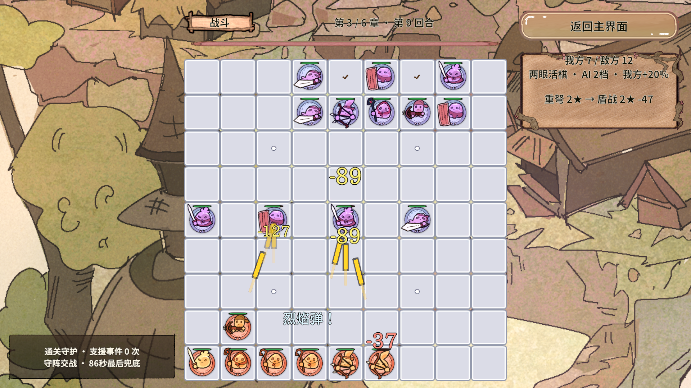
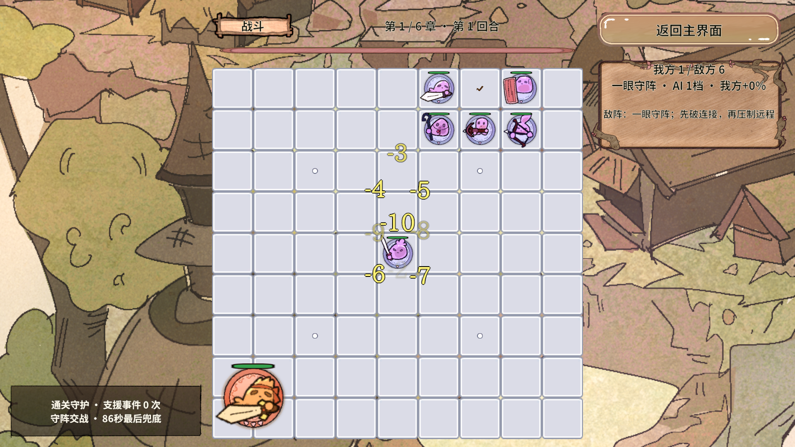

# RevGame 弹幕密度与视觉冲击调整

2026-10-18 · Unity 2022.3.15f1c1 · 1920×1080手机横屏

## 这次改了什么

针对试玩中“飘字偏少、远程弹道太细小”的反馈，提高受控显示密度，把同帧攻击分批播放成连续齐射，并放大弹头、增加深色轮廓和短拖尾。伤害、攻击频率、AI、气眼规则、六张手牌、横屏分辨率继续沿用当前玩法；此次调整只发生在表现层。

## 最新参数

| 项目 | 上一版 | 当前版本 |
|---|---|---|
| 同时显示的攻击口号和伤害数字 | 最多6条 | 最多10条，异步加载预约也占名额。 |
| 新文字最小间隔 | 0.16秒 | 0.09秒。 |
| 攻击口号全场间隔 / 同棋间隔 | 0.9秒 / 3.5秒 | 0.55秒 / 2.2秒，同时最多3条。 |
| 伤害数字合并窗口 | 0.32秒 | 0.22秒，同目标仍合计，避免连续命中完全重叠。 |
| 数字待播上限 | 12个目标 | 20个目标；超过1.2秒的显示仍丢弃。 |
| 活动弹道（含加载预约） | 最多6条 | 最多14条。 |
| 同帧多次命中 | 全场间隔0.065秒，其他同帧弹道被略过 | 24条容量的短队列，平均每0.025秒播放一发，每帧最多补两发；超过0.5秒的旧弹道不补播。 |
| 弹头本体尺寸 | 0.38×0.10世界单位 | 0.82×0.24，长度约2.16倍、厚度2.4倍，带轻微发射脉冲。 |
| 弹道层次 | 单张图 | 本体、深色轮廓和45%透明的短尾，共用原图与材质。 |
| 飞行时间 | 0.30秒 | 0.36秒，末段淡出，让小屏更容易看清运动。 |

攻击口号现在只在至少6个伤害目标积压时让位，不再因为有一条数字待播就完全不出声。数字仍是优先信息。文字继续在棋盘内寻找12个避让位置，无法避让时，下层文字为35%透明，动画淡出比例继续相乘。

这些值是显示上限和节流参数，不是凭空生成攻击的数量。队列只保存真实命中快照，每条轨迹只负责播放，不再次扣血。同帧齐射改为相邻画面帧逐发出现，以减少同帧重叠，也不会无限积压旧战况。

## 弹道预制体和对象池

通过 Unity MCP 执行 `GameFeelBuilder.ApplyProjectileStyle()`，保存 `Assets/GameRes/Effects/BattleEffect.prefab`。尺寸与时长作为序列化字段保存在预制体中；生成工具也同步这些值，重复装配不会复制子节点。

轮廓和短尾是同一个 RevPool 实例的两个子 SpriteRenderer，编辑器装配时创建一次；每次开火只启用它们。没有为拖尾单独申请对象，没有在每帧生成粒子或轨迹网格。单个 DOTween 推进位置、发射脉冲与末段透明度，回池仍执行 `Kill(false)`。

弹道复用成伤害文字、攻击口号或帧动画前会显式隐藏轮廓和拖尾，防止旧尾巴粘在新效果上。敌我弹道采用金黄/橙红色相区别，深色轮廓帮助浅色棋盘上的识别。短尾有固定长度，不会随着飞行距离越来越长。

阶段切换同时清伤害聚合队列、弹道短队列、活动实例及加载预约；旧加载回调仍须检查代次，不能把旧弹幕补到下一轮准备阶段。

## 代码入口

| 文件（相对Unity工程） | 本次职责 |
|---|---|
| Assets/GameScripts/View/BoardView.Feedback.cs | 十条文字/十四条弹道预算，真实齐射短队列、节流、过期丢弃与阶段清理。 |
| Assets/GameScripts/View/BoardView.cs | 真实命中进入显示队列，把目标阵营传给弹道，保留原伤害快照。 |
| Assets/GameScripts/View/BattleEffectView.cs | 序列化尺寸、归一化源图、轮廓/短尾、阵营色、发射脉冲与回池复位。 |
| Assets/Editor/RevGame/GameFeelBuilder.cs | 可单独由MCP执行的预制体装配，不重建场景。 |
| Assets/Editor/RevGame/GameReadabilityChecks.cs | 同帧齐射、实际放大尺寸、密度上限、避让与有内容队列的跨轮清理验收。 |
| Assets/Editor/RevGame/GameFeelChecks.cs | 原回池/复用检查，增加“弹道转成文字后没有残留子图”的断言。 |

新增和修改的关键字段、方法与队列调度均有中文注释，解释“为什么要排队”“为什么预约也计数”“为何要隐藏复用残留”，便于新手沿着事件→队列→池对象→回收阅读。

## 验证证据

本轮使用 Unity MCP 编译并进入真实 Play。`GameReadabilityChecks.Begin()`最终49条断言通过，覆盖120次同目标伤害聚合、100个目标风暴、放大弹头与可见子图、队列长度、活动数量、避让与下层透明、事件居中、战斗换位，以及先塞满两个队列再切轮的清理。峰值实测十条飘字、十四条弹道，真实模型未被表现快照额外扣血。断言按整组弹道检查，数量不随某一帧恰好显示几发而改变。

对象池检查验证动画启动、中途回池、同实例立即复用、弹道转文字无残留，以及4秒后没有旧回调、Tween数量恢复。

上图由正常战斗时钟推进，使用真实手牌落子及合法刷新准备远程阵容，没有注入伤害快照；仅用于观察表现，不是随机任意阵容的平衡证明。另一张密集反馈图来自受控表现风暴测试，验证显示预算，不代表正常对局伤害。

本轮未重新运行不受影响的纯规则、全战役数值或手机真机性能测试，不能把前轮的643/737/1280条数字当成本轮重跑结果。当前没有真机帧率、内存或触摸测试结论。布局继续固定按1920×1080横屏设计。

准备横幅1.67秒、援军按气眼选位、战斗主动换位等既有行为见[前轮修复报告](RevGame-战斗可读性与援军修复-2026-10-18.md)；其中六条文字/六条弹道和较小弹头的参数已被本报告覆盖。
