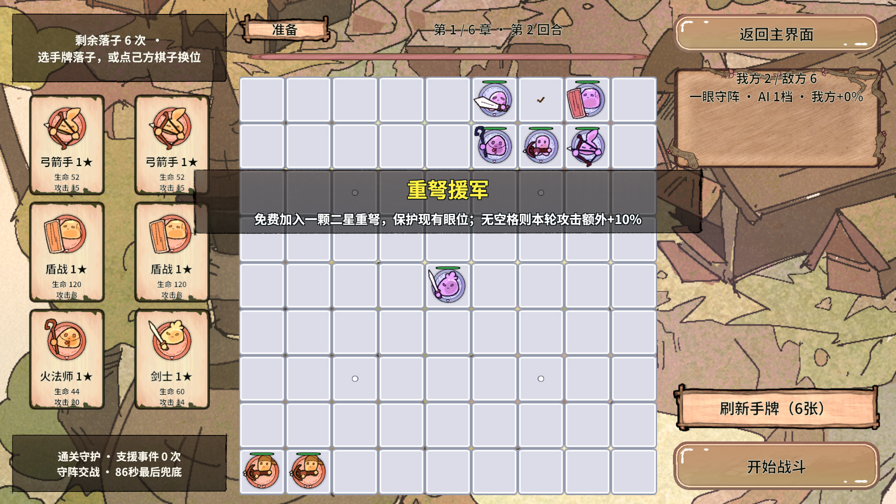

# RevGame 成长、原位升级与准备增益验收

2026-10-18 · Unity 2022.3.15f1c1 · 1920×1080 手机横屏 · 六张手牌

## 本轮完成了什么

已实现逐章逐轮成长的敌方阵容和分档 AI、两张同类牌触发原位升级、15 种准备增益、准备横穿弹幕、进度条缓动和 Boss 序列帧修复。代码继续使用 Revolution 的服务、域时钟、事件与对象池；没有修改 Assets/Revolution 框架快照。本项目第一交付物仍是框架在真实业务中的可行性证据。

### 敌人如何逐步增强

以 `P = (章节 - 1) × 11 + 回合 - 1` 表示连续进度，跨章不归零。

| 项目 | 当前实现 | 玩家能感知的变化 |
|---|---|---|
| 普通敌棋数量 | `min(19, 6 + floor(P / 5))`，Boss 大棋另计 | 从6名逐步增加到19名，不会换章又降回6名 |
| 基础生命倍率 | `9.6 × (1 + 0.018 × P)` | 每回合都提升，叠加图鉴星级后的基础生命 |
| 基础攻击倍率 | `1 + 0.009 × P` | 每回合都提升，作用于运行期棋子而非共享图鉴 |
| 普通敌棋星级 | 第1～2章一星、第3～4章二星、第5～6章三星 | 跨章节获得更强图鉴属性；Boss不再临时提高普通兵星级，避免下轮倒退 |
| 兵种 | 必含重弩、弓箭、火法；盾战、重剑、剑士补足 | 有远程压制和守眼连接，沿用各自射程、阻挡、炮架规则 |
| AI档位 | `min(4, 1 + floor(P / 17))` | 1档就近；2档识别远程威胁；3档收残血、压气；4档评估反击火力、优先打脆弱连接并保护主将 |
| 阵型安全 | 每个候选在棋盘深快照试算 | 不拆已有眼，不把原本有气的同伴堵成零气，不污染真实棋盘 |

双牌升级不再消耗棋子，因此继承阵容可能迅速变大。额外动态压力参考继承己方活棋的星级总量 `S`：`Q=max(1,S/6)`，敌方生命再乘 `min(16,Q²)`，攻击再乘 `min(4,√Q)`。**基础成长随关卡递增；这层额外压力会随当前继承阵容变化。** 目的在于避免十几颗远程几秒清场、随后堆满棋盘。它是当前原型的平衡参数，正式数值还需要后续调校。

我方继续原地守阵；敌人仅在没有射程内目标、移动冷却结束且试走安全时接近，每5秒至多移动一格，马步保留原走法。智能提升不会让棋子又恢复零点几秒乱跳。

### 为什么仍能通关

默认通关辅助仍保留最后一颗己方棋至少1血；双方正常攻击、阵亡和破阵继续发生。普通战斗上限90秒，Boss不限时；僵持支援最早36秒介入，74秒进入逐个击破，86秒后清理异常残敌。按0.3125秒固定模拟步，最终截止通常落在86.25秒。收尾通过真实扣血与受击事件完成，并非直接把结算结果改成胜利。

战斗事件改为开战6秒首次触发、之后每7秒一次，每轮最多12次。援军、治疗、回气、补眼、连击、炮火和断链等正向事件轮换，避免只给没有合法目标的效果。

通关保障的前提是正常开始战斗且至少有一颗己方活棋；关闭辅助的开发验收模式不承诺必胜。人为造满棋盘、完整大棋无出生空间时仍明确拒绝并保留现场，不会为了过关悄悄删除玩家棋子。两组真实连续闯关样本已验证下轮可以正常生成；有限样本不等于穷举所有布阵。

### 两张同类牌怎样升级

每种棋种分别累计本次战役里**成功打出的手牌**，每逢第2、4、6……张，升级一颗已在场、活着且未满星的同类棋。优先培养最早入场的棋，满三星后培养下一颗。不要求两张牌星级相同，因而普通一星手牌也能把原棋逐步养到三星。

例如第一颗弓箭手在(2,0)：第二张弓箭手打到(3,0)，原棋在(2,0)变二星，新棋留在(3,0)。第四张同类牌可以继续把原棋养到三星。升级保留对象、Id、坐标、占格和伤势比例，不移走任何棋子，也不消耗守眼材料；一格棋升到三星仍是一格。直接打出的原有三星大棋手牌仍遵循自己的2×2体型。

失败落点、刷新手牌、自动援军不计入双牌累计；跨回合保留计数，重新开始战役才清零。没有可升级的旧棋时仍正常落新棋，不把新棋偷偷吞掉。现有升级世界特效与UI提示继续触发，并且视图会识别同Id的新星级，立即切换外观。

## 15种准备增益

每次进入准备阶段约3秒后，洗牌抽取3～5种不重复增益，先统一生效，再排队播报。固定驱动步为0.3125秒，实机正常落在第3.125秒左右。没有己方棋时也保存团队效果和待升级次数，后续落子可享受；回复储备会保留到首次受伤。开战按钮在这约3秒期间显示倒计时，防止过早点开战而漏掉整批奖励。

| 序号 | 名称 | 真实效果 | 生效范围 |
|---|---|---|---|
| 1 | 天赋觉醒 | 随机己方棋原位升一星；没有未满星目标时，保留一次升级机会给后续入场的棋。 | 升星永久保留 |
| 2 | 重弩援军 | 免费加入二星重弩，不消耗手牌或落子额度，不填已有眼位；无安全空格改为本轮攻击加成+10%。 | 新增棋子按正常残局保留 |
| 3 | 全军奋起 | 本轮全体攻击加成+25%，之后入场的棋也享受。 | 本轮 |
| 4 | 复苏储备 | 立即回复全队40%最大生命；本轮首次实际受伤后，再回复全队40%。 | 本轮，储备仅一次 |
| 5 | 不屈活棋 | 即使零气仍可攻击，免疫锁死和孤立增伤；气眼的真实计算和显示继续保留。 | 本轮 |
| 6 | 疾风连击 | 全队攻击速度+25%，不改变敌我移动间隔。 | 本轮 |
| 7 | 生命绽放 | 全队最大生命+30%，当前生命按原伤势比例同步，换轮移除加成。 | 本轮 |
| 8 | 坚壁守护 | 全体受到伤害降低20%。 | 本轮 |
| 9 | 汲取之力 | 普通攻击回复实际伤害20%的生命，按整数结算。 | 本轮 |
| 10 | 生生不息 | 战斗每4秒回复全队4%最大生命。 | 本轮 |
| 11 | 三重护盾 | 每颗己方棋抵挡前3次伤害，新入场棋也获得；旧棋不会因刷界面补满护盾。 | 本轮，每棋三次 |
| 12 | 远射专精 | 远程棋攻击加成额外+35%。 | 本轮 |
| 13 | 破阵追击 | 攻击生命比例低于35%的敌人时，攻击加成额外+50%。 | 本轮 |
| 14 | 慧眼共鸣 | 成眼棋攻击加成额外+30%，战斗每4秒回复6%最大生命。 | 本轮 |
| 15 | 气脉畅通 | 全队额外获得2口气，后续落下的棋也享受。 | 本轮 |

当前15种效果及其说明由 `PreparationBuffCatalog` 和战斗服务维护；它们尚未导成正式Excel数值表。原有攻击、伤害、升级、战斗事件的22条表数据继续走Revolution导表工具，未手改生成代码。本轮额外修正了Excel里的两条旧升级说明：不再显示“三合一”或“升三星扩大为2×2”。

## 弹幕、进度条和Boss修复

准备提示使用 `RevPool.GetAsync<BattleEventNoticeView>`，每次只播放一条：右侧屏外0.46秒飞入、停顿1.25秒、0.16秒放大至1.12倍、0.24秒回弹、0.46秒飞出左侧。总时长2.57秒；3～5条约7.71～12.85秒。黄色标题、白色说明均加粗居中，配深色描边和底板。动画不挡点击，可提前开战；已发放效果保留，未播完提示会清理。

横幅使用归一化行程，每帧按画布重算实际屏外边界。整体设计分辨率继续是1920×1080，不修改横屏方向。右栏升级提示和准备横幅分别管理，打牌升级不会把待播增益队列吞掉。

上图在动画停顿时定格用于检查排版；正常播放会自动离场。开战、换轮、结算和返回大厅都会清掉活动提示、队列、失效异步请求和所属Tween。回池时`Kill(false)`并清完成回调，防止旧回调作用到复用对象。横幅自然结束先归还再通知队列，使下一条能够复用同一个实例。

顶部时间条及Boss血条使用0.28秒`Ease.OutCubic`缓动。只有目标值真的变化才续接Tween，每0.1秒HUD刷新不会重启相同动画；切阶段即时归位并取消旧Tween。

Boss原问题有两处：`SetBodySize`反复写静态立绘；`OnTick`发现Boss静态图后不再推进可见帧。源素材中两张Boss大棋图都是单张Sprite，没有专门Boss序列。本轮让Boss使用现有敌方三星重剑的真实3帧、0.2秒间隔序列，保留2×2/3×3体型、王冠与光环。它不是仅缩放一张静态图的假序列帧。构建器和棋子预制体也同步移除了静态覆盖引用，重新生成资产不会带回旧问题。

## 代码在哪里，为什么这样写

路径以下均从 `RevGame_Client/UnityProject/RevGame.Unity/Assets` 开始。

| 文件 | 关键职责与新手需要理解的地方 |
|---|---|
| `GameScripts/Data/LevelCatalog.cs` | 连续进度、敌方数量/属性/AI档位；基础数据不写进UI |
| `GameScripts/Battle/EnemyFormationPlanner.cs` | 对完整敌阵做快照预检，后期布阵增加对玩家火力的评价 |
| `GameScripts/Battle/EnemyTactics.cs` | 随档位开放目标选择、压气和避免集火，所有档位都守住保眼安全底线 |
| `GameScripts/Pieces/Piece.cs` | `UpgradeInPlace`只换图鉴和属性；临时生命按基础值重算，快照复制护盾/免疫状态 |
| `GameScripts/Services/BattleService.Progression.cs` | `RegisterPlayedPair`只在成功消费牌后调用，删除旧的三合一循环 |
| `GameScripts/Data/PreparationBuffCatalog.cs` | 十五种不可变增益名称及效果说明 |
| `GameScripts/Services/BattleService.Preparation.cs` | 准备时钟、唯一发放、本轮加成、延期升级、新入场继承、持续回复和换轮重置 |
| `GameScripts/Services/BattleService.cs / Events.cs` | 接入真实攻击倍率、吸血、护盾、减伤、免疫和事件节奏；继续从统一出口派发真实伤害 |
| `GameScripts/Flow/BattleLogic.cs` | 同一域时钟同时驱动准备和战斗；返回大厅后域回收，不留跨界面的准备计时器 |
| `GameScripts/View/BoardView.cs / PieceView.cs` | 同Id升星切外观、Boss真实帧播放；不把表现变化当业务落子 |
| `GameScripts/UI/BattleHudPanel.cs` | 只读模型，管理准备播报队列及两条血/时间条Tween；代次拦截迟到资源回调 |
| `GameScripts/View/BattleEventNoticeView.cs` | 池化短命零件，DOTween只负责位置/缩放/透明度，动画回调不修改战斗属性 |
| `GameScripts/UI/PreparePanel.cs` | 六张手牌不变，准备增益倒计时，按钮只向Logic转发动作 |
| `Editor/RevGame/GameGrowthPresentationChecks.cs` | 新增真实Play表现断言，编辑器代码放在外部Editor目录 |

关键方法、字段和时序处已写中文注释，解释“为什么”：为何升星不能换Id/扩大占格，为什么临时生命不能反复相乘，为什么给空棋盘的增益不能直接丢掉，为什么旧加载回调需要核对代次，以及为什么回池后不能再触发上一条动画的完成回调。

## 实际验收证据

| 检查 | 本轮结果 | 覆盖范围 |
|---|---|---|
| Unity编译 | 0个编译错误 | 实际编辑器刷新编译 |
| `GameRuleChecks.Run()` | 620条通过 | 15种增益真实伤害/治疗/护盾/免疫、延时与唯一发放、双牌原位升级、占格、失败事务、支援等 |
| `GameLayoutChecks.Run()` | 737条通过 | 五种横屏尺寸×三种安全区、六牌、棋盘和侧栏布局 |
| `GameTacticsChecks.Run()` | 1280条通过 | 66种敌阵、成长不倒退、实际AI目标变化、快照隔离、两组连续66回合等 |
| `GameRoundPresentationChecks.Begin()` | 136条Play回归通过 | 六牌重发、暂停翻牌/升级/支援后换轮、迟到伤害与日志清理 |
| `GameGrowthPresentationChecks.Begin()` | 23条Play断言通过 | 真实3秒准备计时、横幅方向/停顿/放大、队列清理、Boss可见Sprite换帧、时间/血条缓动 |
| `GameFeelChecks.BeginPoolCheck()` | 通过 | 中途回池Kill、同实例复用、等待4秒后没有旧回调且Tween数恢复 |
| Revolution导表工具 | 2表/22条数据，更新1个数据文件 | 仅数据模式重导`BattleText.txt`，未修改生成类结构 |
| 电脑实际点击 | 通过 | Play、冒险关卡、第一章、选弓箭牌、两次指定格落子、原位二星、开战清理横幅 |

固定种子六个独立样本实际时长约16.25～86.25秒，双方均有真实受伤，事件2～12次。连续战役种子20261018与701各完成66回合，分别累计691次和676次事件。测试通过不等于正式平衡已完成，也不代表手机真机性能数据。

### 在Unity里复验

1. 当前本地场景是`Assets/Scenes/GameScene.unity`。保持Game预览1920×1080，按Play。
2. 点“冒险关卡”→第一章，等待约3秒，观察3～5条准备增益依次右入左出。
3. 刷出两张同类牌，分别落在两个空格；观察原棋原位升级，新棋仍在第二个指定格。
4. 点击开始战斗，准备横幅应立即清理；观察顶部进度缓动、攻击/伤害飘字、正向战斗事件。
5. 开发GM可加载`RevGame/载入验收场景 boss`，检查主将王冠、大棋身体和持续换帧。
6. 非Play运行三组规则/布局/战术断言；Play在主界面分别运行三组表现检查，等每组结束再运行下一组。

本地已有的SampleScene→GameScene改名属于用户既有改动，本轮不把它冒充为新增功能或覆盖还原；代码不依赖场景名。远端旧场景名与本地改名应按团队下一次场景整理统一。

## 当前完成范围与尚未完成

可玩的原型闭环已具备：大厅/选关、六章66回合、六牌/刷新/全盘落子/免费重摆、气眼/敌方保阵AI、双牌原位升级、普通与Boss战、战斗和准备增益、奖励/跳过、攻击/伤害/升级/事件动画，以及换轮和退出清理。Revolution的FSM、Scope、Logic、服务、异步资源、事件、计时器、数据表和对象池已在这些业务中共同运行。

仍未完成的是正式平衡与手机真机性能/触屏验收、专门Boss序列资源、基础血攻/关卡/准备增益的正式Excel数值表，以及存档/成就/长期内容等更完整的产品需求。本轮没有凭一个比例宣称整款游戏已经100%完成。新增成长与保障参数属于可调的原型数值；后期样本较多依赖收尾支援，继续做平衡时应重点减少这种依赖，并保留可复现测试。
