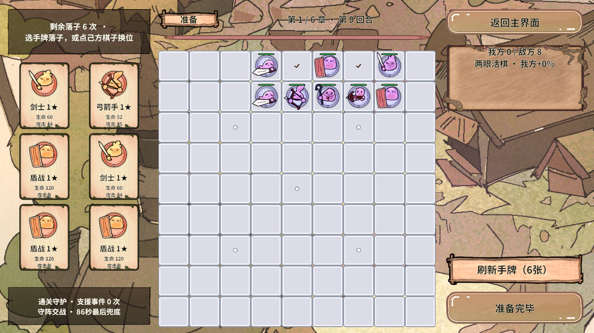
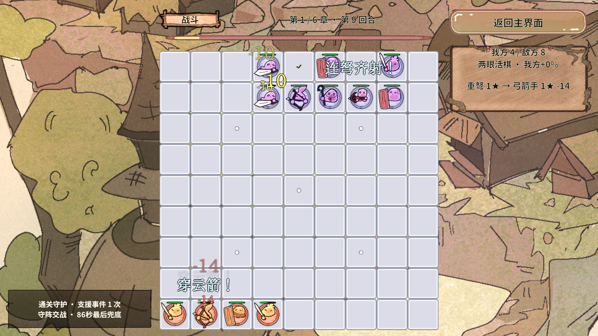
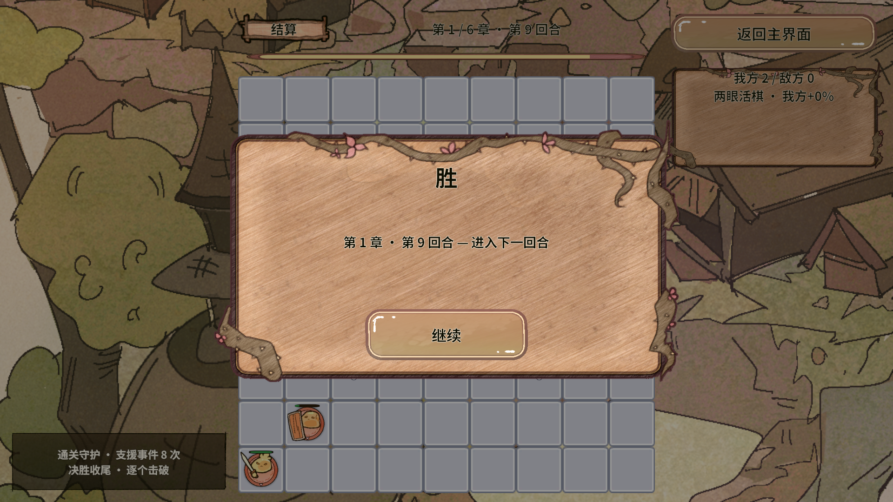

# RevGame 战斗节奏与围棋 AI 改造验收

更新日期：2026-10-18。Unity 2022.3.15f1c1；原型布局基准保持 **1920×1080 横屏**。

本次已经实现“战斗展开更久、增加敌方数量与远程、按气眼布阵、低频保阵移动、保留最终通关保障”。这是前一份《开发总结与明日计划》中战斗改造部分的实施记录。项目的首要交付仍是 Revolution 框架在真实业务中的可行性结论。

## 1. 玩家现在能看到什么

| 内容 | 当前行为 | 玩家能感受到的变化 |
|---|---|---|
| 敌方普通棋数量 | 每轮 6～10 名，Boss 身体另计 | 前期也有完整阵型，后期有更多连接子和机动前排。 |
| 敌方远程 | 每轮都有重弩、弓箭、火法 | 重弩可以跨盘施压，弓箭六格直线射击，火法保留隔子攻击。 |
| 一眼阵型 | 五颗相连的守子围成一只独立的眼 | 早期敌人会守眼；眼位保持为空，并有实际气数。 |
| 两眼阵型 | 八颗相连的守子围出两只独立的眼 | 普通敌棋达到八名后优先做两眼，触发现有两眼回血规则。 |
| 棋子移动 | 我方保持玩家布阵；成眼敌群不主动移动 | 不会为了追人把眼拆掉。未成眼的敌人只有射程不足时才低频试走。 |
| 战斗长度 | 普通回合上限 90 秒，可提前获胜 | 留出交战、治疗、补眼和反击的过程，不强制每局都打满时间。 |
| 战斗事件 | 第一次约 8 秒，此后每隔至少 9 秒 | 援军、回气、治疗、补眼、连击、炮火、断链依次展开。 |
| 最终通关 | 最后一颗己方棋子保留至少 1 血，后段支援逐步破阵 | 允许真实阵亡、互相消耗，再通过实际伤害取得胜利。 |
| 现有操作和表现 | 六牌刷新、全盘落子、准备期重摆、DOTween 池化弹幕继续使用 | 本次没有改变横屏设计基准或指定美术资源。 |

“两眼活棋”沿用本游戏的定义：保护阵型、周期回血；仍然会受到战斗伤害，并非传统围棋中永远无法提取的绝对无敌状态。

## 2. 敌人如何真正做出眼，而不是只显示一个名称

`EnemyFormationPlanner` 负责出生布阵。它先在独立棋盘中放入上一回合仍存活的己方棋子，再试放敌方完整名单。每次候选都调用真实 `GoRules.Evaluate`，检查连通块、气、眼和锁死状态，验证通过后才一次性提交坐标。

一眼模板使用五颗守子，两眼模板使用八颗。下面是贴边模板的局部示意；`敌`是同一个连通棋群，`眼`必须是空格，上方是棋盘内部，下方是棋盘边缘：

```text
一眼（五颗）        两眼（八颗）
敌 敌 敌           敌 敌 敌 敌 敌
敌 眼 敌           敌 眼 敌 眼 敌
────────           ──────────────
```

程序会尝试四条边及有限的平移位置。评分优先看远程是否真的存在攻击目标，再考虑气和位置；这里查询真实射程，不靠棋子名字判断它能不能打。额外普通棋优先作为与眼阵保持间隔的机动前排，避免所有近战都连进守眼骨架后整场站着等人。

玩家残局会限制出生空间。算法按“两眼 → 一眼 → 合法散阵”降级，并保留明确说明。它不会填掉已有的玩家眼位、降低玩家已有眼数，或把原本有气的玩家直接生成成零气。Boss 的 2×2、3×3 身体完整预检，剩余名单优先放大身体，不能出现“名单里有 Boss，棋盘上却没放出来”。如果整队确实放不下，保持原回合并给出原因，不偷删棋子。

### 为什么必须深复制

`BoardModel.CreateSnapshot()` 和 `Piece.CreateSnapshot()` 复制坐标、当前/最大生命、气、眼、行动进度等可变字段，只共享只读图鉴。`GoRules` 会把气和眼写回棋子，因此“只复制棋盘数组、里面仍引用原棋子”会污染实战。现在所有 AI 试算都在独立快照中完成，真实棋盘只接收最终动作。

## 3. 敌人怎么攻击、怎么保阵

敌人已有目标就先攻击，优先收残血、压制远程，再比较距离和稳定编号。我方远程保留原来的跨盘守阵输出；敌方重弩也能跨盘，确保后排守眼棋子有真实输出。敌弓仍要求六格以内的直线、受棋子阻挡；火法仍需要一颗炮架，职业差异没有全部抹平。

普通行动周期仍为 1.25 秒。我方远程沿用原 Excel 倍率，默认约 0.625 秒一次。服务和驱动使用 0.3125 秒固定小步，让远程两次出手分开显示。双方普通单发伤害统一乘 0.6，敌方生命采用 2.4 倍原型系数，让交战有可观察的消耗过程。

敌人没有攻击目标时，最多每五秒考虑一次移动。`EnemyTactics.ChooseSafeMove` 对候选格逐个深复制试走：不填眼、不减少任何原有敌群的眼数、不把有气同伴堵成零气；在此基础上才比较是否打开射界或真正接近玩家。没有安全进展就等待，避免左右横跳。眼阵中的棋子直接保留原位，不执行追击。

这是一套有限模板和局部评估 AI，已经表现出气眼特征；它没有实现全盘搜索、围棋棋力引擎或任意残局的最优战术。

## 4. 事件与必胜保障怎样配合

自动增益按“援军 → 回气 → 治疗 → 补眼 → 连击 → 炮火 → 治疗 → 断链”轮换。首次约 8 秒，此后至少间隔 9 秒；支援阶段大提示会额外给普通事件留出阅读间隔。没有合法目标的事件仍明确转为治疗。六牌已全部打完也能获得援军；己方没有活着的远程时补弓箭，否则补盾战。

炮火伤害取“25”和“目标最大生命的 12%”中较大值，避免后期血量上升后炮火没有实际效果。新支援继续使用既有 Excel `Event_决胜支援` 表现配置，阶段细节通过 HUD 与日志说明；所有伤害仍走唯一扣血出口，弹幕显示实际扣血。

| 阶段 | 触发条件 | 实际作用 |
|---|---|---|
| 正常交战 | 开战后先自由交战 | 普通攻击、真实阵亡、两眼回血和自动事件正常运行。 |
| 僵持支援 | 36 秒后，连续 9 秒没有敌方受伤，或己方已危急 | 每 3 秒集火一名敌人，伤害至少 25，或其最大生命的 35%；不会直接默认清场。 |
| 决胜收尾 | 74 秒后仍未结束 | 约每秒逐个击破残部，优先主将，再远程，最后其他敌人。擒王仍走原胜负规则。 |
| 最后兜底 | 86 秒后仍有异常残部 | 下一次支援脉冲用实际伤害清理存活敌人；受固定小步量化，86 秒不是逐帧精确承诺。 |

最后一子守护只限制最后一颗己方棋子不被扣到零血，前面的棋子仍可能阵亡。普通模式保留 90 秒上限；Boss 规则仍是擒王、不按普通超时判定，但开启通关守护时也受渐进支援保障。验收可构造 `BattleService(false, seed)` 关闭辅助；正式入口默认开启。

支援阶段、最后受伤时间、下一次脉冲和提示标记都属于当前回合，在 `StartRound` 统一清零，没有新增脱离回合的定时器。上一轮延迟弹幕、翻牌与提示仍由现有代际校验和回池清理处理。

## 5. 代码在哪，维护时先看哪里

下列路径都以 `UnityProject/RevGame.Unity/Assets` 为起点，关键算法、事务、字段和试算原因已写中文新手注释。

| 文件 | 本次改动及理解顺序 |
|---|---|
| `GameScripts/Data/LevelCatalog.cs` | 普通敌方名单 6～10 名；固定三种远程；正式阵容表接入前的可运行占位规则。 |
| `GameScripts/Battle/EnemyFormationPlanner.cs` | 新增。模板、旋转、保眼、完整占格、降级与最终提交，先理解“试算不能改实战”。 |
| `GameScripts/Board/BoardModel.cs`、`Pieces/Piece.cs` | 深复制棋盘和棋子，精确保留最大生命，避免 AI 试走污染原对象。 |
| `GameScripts/Battle/EnemyTactics.cs` | 新增。目标优先级和低频安全移动评估，返回建议，不直接改变实战。 |
| `GameScripts/Battle/MoveRules.cs` | 敌重弩跨盘、敌弓六格、保留火法炮架规则和守眼禁动。 |
| `GameScripts/Services/BattleService.cs` | 完整名单预检后提交；调用战术算法；统一普通攻击节奏系数；可选固定种子。 |
| `GameScripts/Services/BattleService.Events.cs` | 事件轮换、比例炮火、援军补远程、阶段式保障及回合状态。 |
| `GameScripts/Core/Consts.cs` | 本轮时长、频率、生命与伤害原型参数，正式 Excel 到位后替换数据来源。 |
| `GameScripts/Services/IBattleService.cs` | 对外只读敌阵和保障阶段，HUD 不去修改战斗私有字段。 |
| `GameScripts/UI/BattleHudPanel.cs` | 在现有两行区域显示阵型和支援状态，完整降级说明留给 GM。 |
| `GameScripts/Flow/BattleLogic.cs` | GM 快照补充敌阵、支援阶段、战斗时间。 |
| `GameScripts/Bootstrap/GameGmCommands.cs`、`Services/BattleService.Diagnostics.cs` | 开发白名单新增一眼/两眼验收场景，走真实服务入口。 |
| `Assets/Editor/RevGame/GameTacticsChecks.cs` | 新增战术与连续闯关验收，不放在 GameScripts 内，不进入手机运行时代码。 |
| `GameScripts/Services/BattleService.Checks.cs` | 事件冷却检查真正跨过固定步边界，避免把 9 秒累计中的 8.75 秒误当作已满冷却。 |

## 6. 实际验证结果与范围

本次经 Unity MCP 使用当前 Unity 编辑器执行；编译未发现 `error CS`。以下都是本轮实际结果，不引用历史执行冒充新验收。

| 验证 | 本次结果 | 覆盖边界 |
|---|---|---|
| `GameTacticsChecks.Run()` | **1150 条通过** | 66 个完整敌阵、真实眼数、气、完整名单、远程射界、保眼移动、深复制、空间不足降级/拒绝、六组战斗和两条连续闯关路径。 |
| `GameRuleChecks.Run()` | **570 条通过** | 原有落子、重摆、刷新、合成、Boss、事件、清理等真实业务规则回归。 |
| `GameLayoutChecks.Run()` | **737 条通过** | 多尺寸/安全区纯几何回归；不会把实际编辑器预览改成其他分辨率。 |
| `GameRoundPresentationChecks.Begin()` | **136 条通过** | 剩 1/0/4 张换轮后仍六牌，暂停翻牌/升级/提示清理，迟到伤害拦截和日志清空。 |
| `GameFeelChecks.BeginPoolCheck()` | **通过** | 在稳定 Home 中等待完整四秒；伤害/弹道/攻击/升级/增益回池 Kill、实例复用，无旧回调，Tween 总数恢复。 |
| 真实 Play 观察 | **两眼准备 → 战斗 → 结算通过** | 实际 1920×1080 运行 77.1875 秒，8 次事件后 Player 获胜，有实际伤害飘字；不是同帧快进截图。 |

### 六组独立战斗样本

每组新建服务，固定随机种子，实际放下六张初始牌再开战。后期样本故意使用初始弱阵容，用于确认不会死锁、双方确有伤害及通关保障有效，不能等同于连续成长后的正常难度。

| 章/轮 | 战斗秒数 | 普通事件数 | 我方实际受伤 | 敌方实际受伤 | 结束阶段 |
|---|---:|---:|---:|---:|---|
| 1/1 | 20 | 2 | 55 | 1069 | 正常交战获胜 |
| 1/9 | 76.25 | 8 | 477 | 1679 | 决胜收尾 |
| 3/1 | 72.5 | 8 | 459 | 2140 | 僵持支援 |
| 3/9 | 77.1875 | 8 | 531 | 3480 | 决胜收尾 |
| 6/1 | 76.25 | 8 | 623 | 4874 | 决胜收尾 |
| 6/9 | 77.1875 | 8 | 379 | 6333 | 决胜收尾 |

### 两条连续六章路径

同一个服务从第一章开始，继承己方残局，每轮尝试把六牌依次放到首个合法格，章节奖励固定选第一项，调用真实结算/奖励继续入口。两组均连续赢下全部 66 回合，最终通关通知各恰好一次。

| 随机种子 | 连续结果 | 累计战斗时间 | 累计普通事件 |
|---|---|---:|---:|
| 20261018 | 66/66 回合取胜 | 3435.313 秒 | 349 |
| 701 | 66/66 回合取胜 | 4033.125 秒 | 415 |

这是模型层快速推进验证，未在画面中实时观看完两次全流程，也不能证明任意玩家布局都已平衡。另一次单独的 66 个空盘敌阵生成合计 181ms，是编辑器单次测量，不是手机性能指标。

### 实际截图







## 7. 新手怎么复验

打开 `Assets/Scenes/SampleScene.unity`，保持唯一 Game 预览为 `RevGame 1920x1080` 后按 Play。正常流程点击“开始闯关”→第一章，观察早期一眼敌阵，六牌布好后开始战斗。

快速观察两眼：在开发 GM 面板中，先进入战斗，再执行 `RevGame/载入验收场景 enemy-two-eyes`。它加载第一章第九轮的真实阵容与正常六张手牌，不偷加玩家三星大棋。`enemy-one-eye` 用于观察第一轮。`RevGame/快照` 会输出气、眼、敌阵、支援阶段和时间。

纯规则验收在退出 Play 后经 MCP 执行 `return RevGame.Editor.GameTacticsChecks.Run();`。Play 表现验收要等待其 `LastResult` 完成；池化验收放在稳定 Home，四秒内不要切域、停 Play 或重编译，否则外部动画数量变化会让测试前提失效。

## 8. 目前的结论与剩余工作

**Revolution 公开门面足以支撑这次敌方战术、回合状态、实时 HUD、池化弹幕和受控 GM 验收。** 业务仍由现有服务、FSM、Scope、Logic、事件和 UI 连接，没有新增框架内核或绕过门面。本次没有修改 `Assets/Revolution` 快照，编辑器扩展仍统一在外部 `Assets/Editor/RevGame`。

本次功能已落地并完成上述编辑器验收。以下内容仍需后续工作：

- 正式数值和关卡 Excel：基础血攻、名单、节奏系数目前仍是可运行原型数据；本轮未修改既有弹幕工作簿、生成代码和两表 22 行数据。
- 更丰富的手工阵型、不同章节的战术风格及大量玩家布阵下的难度调优。多数初始弱阵容挑战后期仍需阶段式支援，这是当前通关保障设计的实际表现。
- Android/iOS 真机触控、性能与可读性、AB 加载/构建和发布链路验收。本轮结论仅覆盖注明的编辑器环境。
- 持久存档、正式关卡内容等前序报告中未完成部分，不能用此次战斗改造替代这些工作。

前序 UI 和交付历史见[开发总结与明日计划](RevGame-开发总结与明日计划-2026-10-18.md)；当前架构入口见[代码架构说明](RevGame-代码架构说明.md)。
