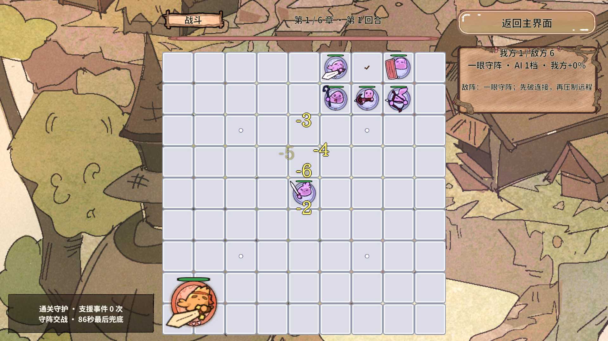

# RevGame 战斗可读性、援军与战斗换位验收

2026-10-18 · Unity 2022.3.15f1c1 · 1920×1080 手机横屏 · 每轮六张手牌

## 本轮结果

已完成战斗飘字控频与避让、重叠下层半透明、准备增益新动画、战斗事件文字居中、援军按兵种选位，以及战斗中点击己方棋子换位。关键接口、字段、候选评分、异步预约和回收逻辑均增加中文注释，说明为何这样处理、失败时保留什么。

本项目首先验证 Revolution 框架在真实业务中的可行性。此次继续由服务负责规则、事件携带快照、RevPool 复用表现对象、DOTween 播放动画；未修改 Assets/Revolution 框架快照。当前交付仍是可玩的框架验证原型，正式数值、全策略平衡和手机性能验收尚未完成。

## 弹幕如何减少并保持可读

这里的“飘字”指棋盘上的攻击口号和伤害数字。升级、准备增益、战斗事件仍由 HUD 的独立池化提示负责，沿用阶段清理和串行/替换播报规则。

| 项目 | 当前规则 | 为什么这样处理 |
|---|---|---|
| 同时显示文字 | 攻击口号与数字合计最多6条，包括已申请但尚未加载好的池对象 | 防止同帧异步加载完成后突破数量上限。 |
| 新文字间隔 | 至少0.16秒 | 不把所有反馈挤在同一帧。 |
| 攻击口号 | 同时最多2条；全场至少间隔0.9秒；同一棋子至少间隔3.5秒 | 口号为低优先级装饰，有伤害数字待播时主动让位。 |
| 同目标连续伤害 | 首次命中约0.32秒后显示累加数字 | 例如120次、每次3点的表现快照只显示一个360。真实扣血仍按每次命中结算。 |
| 待播数字 | 最多12个目标，等待超过1.2秒丢弃旧显示 | 防止几秒后的屏幕还在补播已经结束的攻击。 |
| 弹道 | 最多6条，生成至少间隔0.065秒 | 密集连击不会变成线条墙。 |
| 单条文字 | 数字最长1.1秒、攻击口号最长0.9秒；峰值放大最多1.12倍 | 保留冲击感并尽快腾出视野。 |
| 文字宽度 | 数字最多约屏宽5.5%，口号最多约9% | 防止长文案占满棋盘。原文案、基础字号和颜色继续读取导表数据。 |

**这些限制只筛选表现，绝不减少真实伤害、攻击次数或增益效果。** 达到预算时，略过装饰弹道/口号，数字合并或丢弃过期显示，不回写模型。

避让不是简单地把文字固定排成一列。视图读取文字的实际屏幕包围盒，提前计入放大和上浮范围，在周围12个位置试算，优先选择不重叠、且离原受击位置较近的候选。文字被限制在棋盘可见区域内，避免挤进顶部信息栏、右侧面板和屏幕外。

动画期间每帧继续检查实际矩形。如仍发生相交，按递增显示序号判断前后关系，把旧的下层文字降至35%透明度。遮挡透明度与动画淡出透明度相乘，不能把正在消失的字重新点亮。最多6条文字，成对检查最多36次。

弹道使用 Simple 绘制，并按源 Sprite 的实际尺寸归一化为0.38×0.10世界单位。该源图本身宽约6.17世界单位，直接依赖原图尺寸会造成过长的弹道；现在实际短弹包围盒已通过 Play 检查。

## 准备增益与战斗事件提示

准备期开始3秒后统一发放本轮3～5种增益，生效时间不由动画决定。横幅继续串行播放，每条的新时序为：

| 阶段 | 时长 | 动画 |
|---|---|---|
| 从右侧屏外飞入中央 | 0.46秒 | OutCubic减速进入。 |
| 到中央立刻放大并回弹 | 0.50秒 | 0.20秒放大至1.12倍，0.30秒回到原尺寸。 |
| 回弹后短暂停留 | 0.25秒 | 留在中央。 |
| 飞出左侧屏外 | 0.46秒 | InCubic加速离场。 |
| 合计 | 1.67秒 | 已删除原先到中央后先停1.25秒的流程。 |

战斗事件和升级提示的标题、说明均为粗体居中。除了设置 Text.alignment，也把文字框的锚点、中心和横向偏移统一到面板中心，修复“文字在偏右的框里居中”的问题。BattleEventNotice 预制体通过 Unity MCP 保存，生成工具同步同一坐标，避免重建后复发。

## 天降援兵如何选棋、落棋

1. 优先尝试远程手牌，同类候选按攻击力降序、牌编号稳定排序；实际部署至少二星，三星仍按完整2×2身体处理。
2. 先在棋盘深快照里找到合法落点，再一次性提交和消费手牌。不占玩家手动落子次数，不计入两张同类牌的升级累计。
3. 没有可部署手牌时，默认开启的辅助模式尝试免费二星重弩。无合法位置时沿用事件失败/支援兜底，不覆盖棋子硬塞。

| 兵种 | 候选选择规则 | 安全约束 |
|---|---|---|
| 远程 | 靠近最大的己方连通阵营，同时远离敌人；距敌不超过2格受到明显评分惩罚 | 不填己方眼、不闯敌眼、不堵死同伴。 |
| 近战 | 必须由真实攻击规则找到可攻击目标，优先可用敌眼，再考虑贴敌位置 | 可尝试敌方空眼；若落下后零气锁死、不能攻击则拒绝。拥有免围困增益时可突入并攻击。 |

每个候选都会刷新快照中的气和眼，比较旧棋眼数及是否从有气变为零气，防止自动增兵拆己方阵型。距离按两块棋子身体最近边缘计算，大棋不只拿左下角算。一次选位仅复制一份棋盘，逐格试放后移除，实战状态不被候选试算污染。

准备增益中的免费重弩也复用相同选位；如果没有安全格，沿用攻击力+10%的替代奖励。

强援提高了早期输出，为保持原有首关至少15秒的节奏回归，本轮将敌方基础生命系数由9.6调整为10.8：`10.8 × (1 + P × 0.018)`，其中`P = (章 - 1) × 11 + 回合 - 1`。首关固定样本从14.375秒回到15.625秒；未改通关保底机制。这仍是原型参数，不能视为正式数值定稿。

## 战斗中怎么换位

准备和战斗阶段统一调用 `IBattleService.HandleBoardClick`：**点一颗存活的己方棋子，再点空格换位**；再次点当前选中的棋子可取消选择。流程由 `BoardView.OnCellClicked → BattleLogic.ClickBoard → HandleBoardClick` 转发。

- 战斗期只允许调整已在场己方棋，不能使用剩余手牌或眼位石。
- 大棋先检查所有身体格，不能越界、覆盖他棋；失败完整保留原棋和当前选择。
- 手动换位保留编号、生命、护盾和攻击进度，不能靠反复点击回血或立即攻击。
- 玩家可主动拆眼或进入敌方空眼；自动 AI 仍遵守原有保眼与移动冷却规则。
- 选中棋死亡、进入结算或开始新轮后清选择，避免留下指向旧棋的编号。

## 代码入口与新手阅读顺序

以下路径均相对 Unity 工程目录。

| 文件 | 建议关注的方法与职责 |
|---|---|
| Assets/GameScripts/Services/IBattleService.cs | `HandleBoardClick`接口与阶段约束；UI只能转发合法动作。 |
| Assets/GameScripts/Services/BattleService.Placement.cs | 点击选择、完整身体预检、成功后移动与刷新气眼。 |
| Assets/GameScripts/Services/BattleService.Reinforcement.cs | 选强援、深快照试放、远程/近战评分、保阵、按身体算距离。 |
| Assets/GameScripts/Services/BattleService.Events.cs / Preparation.cs | 事件消费与准备支援复用，死亡时清选择。 |
| Assets/GameScripts/View/BoardView.Feedback.cs | 显示预算、异步预约、伤害聚合、12候选避让、遮挡检查与重置。partial只是同一个BoardView分文件。 |
| Assets/GameScripts/View/BoardView.cs | 接收真实战斗快照、从RevPool申请实例、阶段切换归还实例。 |
| Assets/GameScripts/View/BattleEffectView.cs | 单个效果的DOTween、屏幕包围盒、前后顺序、遮挡透明度与短弹归一化。 |
| Assets/GameScripts/View/BattleEventNoticeView.cs | 准备横幅时序、普通事件文字几何居中、回池Kill(false)。 |
| Assets/Editor/RevGame/GameReadabilityChecks.cs | Play密集反馈与真实点击入口检查，正式运行时代码不依赖它。 |

阶段切换先使旧加载代次失效，再清队列、预约计数和活动实例。旧异步回调只能归还结果，不能扣新一轮的名额。对象池归还时停止当前 Tween 并丢弃旧回调，不能 Complete 后再触发回池，也不调用全局 KillAll。

## 实际验证与证据范围

通过 Unity MCP 调用本项目真实检查入口，完成编译和 Play 验收；以下为本轮实际运行结果，非仅静态阅读。

| 入口 | 本轮结果 | 覆盖 |
|---|---|---|
| GameRuleChecks.Run | 643条通过 | 新增23条，覆盖战斗换位、完整大棋、状态保留/死亡清选择、远程优先、安全后排、近战射程与敌眼突袭、保护己眼。 |
| GameLayoutChecks.Run | 737条通过 | 横屏布局与既有安全区回归。 |
| GameTacticsChecks.Run | 1280条通过 | 两组固定种子各连续66轮全胜；检查成长、AI和既有通关辅助。 |
| GameReadabilityChecks.Begin | 46条Play断言通过，峰值6条飘字 | 120次同目标合并成360且模型无额外扣血、100目标队列有界、短弹、避让、强制相交下层透明、真实事件居中、战斗点击入口换位、冻结动画后切阶段清零。 |
| GameGrowthPresentationChecks.Begin | 23条Play断言通过 | 准备横幅1.67秒及中央即回弹、Boss可见Sprite换帧、进度条缓动。 |
| GameRoundPresentationChecks.Begin | 136条Play断言通过 | 六牌、回合表现和跨轮清理回归。 |
| GameFeelChecks.BeginPoolCheck | 通过 | 回池Kill、复用同一实例、4秒无旧回调、Tween数量恢复。 |

两组连续战役种子分别为20261018、701，总模拟时长5018.438秒、4977.5秒，累计触发676、673次事件。六个独立样本的战斗时长分别为：1/1为15.625秒，1/9为56.875秒，3/1为79.0625秒，3/9为80.3125秒，6/1为85.3125秒，6/9为86.25秒。样本通过说明当前回归成立，不能证明任意策略均已完成平衡。

上图为受控表现测试：注入大量命中快照检查限额、避让和透明兜底，测试期间不扣模型生命；不能当成正常实战的伤害数值截图。换位检查调用真实 BoardView 点击处理入口，未把它描述为原生鼠标点击测试。

未执行：Android/iOS真机帧率、内存与触摸验收；AB构建及AB资源加载回归；正式Excel基础血攻/阵容；全策略通关与商业级平衡。此前报告中的2.57秒横幅、准备期限定重摆、9.6基础生命倍率均为历史版本，以本报告和当前代码为准。

## 当前完成度与后续

已具备主界面、选关、六牌与刷新、准备增益、全盘布阵/主动换位、气眼规则、成长敌阵与AI、自动战斗、战斗事件、Boss表现、结算和章节奖励闭环。框架已在这些业务中实际承载流程、域回收、事件、资源、对象池、导表和受控GM检查。

后续仍需正式数值Excel、真机测试、存档及更完整局外成长、音效和表现打磨、人工试玩与后期对保底支援依赖的调优。不同交付标准没有统一分母，不用旧的完成百分比描述当前原型。

前序成长与增益细节见[成长与准备增益验收](RevGame-成长与准备增益验收-2026-10-18.md)，工程入口见[代码架构说明](RevGame-代码架构说明.md)。
