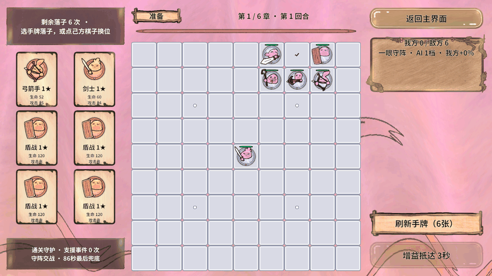
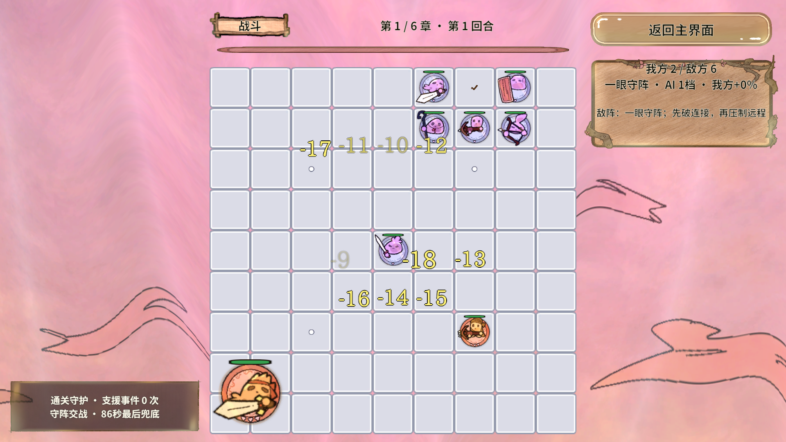

# RevGame 战斗性能、敌方 AI 与 AB 资源规范（2026-10-18）

## 本次交付

本次针对敌方 AI 注释、战斗性能、棋子魔幻渲染、GameScripts 目录和 AB 重复依赖完成了可回归的实现。

- 敌方 AI 核心代码补充了面向新手的中文说明：类职责、字段含义、方法输入输出、安全门槛、评分单位、快照隔离、固定顺序和失败回退均写在 `Battle/AI` 与 `Battle/Rules`。
- `BoardModel` 增加占格版本和复用查询入口；`GoRules` 使用棋盘专属草稿区，减少气眼重算时的临时集合和队列。
- 战斗服务在占格、气数加成或围困免疫真正变化时才刷新气眼；普通掉血不会触发整盘规则和 81 格 UI 重绘。
- 高频走法和射界查询支持调用方传入复用列表；敌方移动和补子试算复用一张独立快照，不移动真实棋子进行试算。
- 新增 `GameBattlePerformanceChecks` 和 `GameOptimizationChecks`，性能报告只描述编辑器规则层测量，不把编辑器数字冒充手机帧率。
- 新增 `GameShader/Pieces/ArcanePiece.shader` 与 `GameRes/Material/Pieces/ArcanePiece.mat`。棋子身体使用单 Pass 古铜/青绿色流光，保持 Sprite alpha、序列帧和对象池生命周期。
- 138 张棋子/状态图片通过 Unity AssetDatabase 保留 GUID 迁移到英文资源目录，避免中文逻辑路径和重复导入。
- GameScripts 59 个脚本按功能细分到 `Battle/AI`、`Board/Rules`、`Services/Battle/Preparation`、`UI/Panels/Battle`、`View/Combat/Effects` 等目录；Editor 代码仍统一位于 `Assets/Editor/RevGame`。
- AB 构建工具新增共享帧、共享状态、共享 Shader 和棋子材质包；构建前运行依赖分析门禁。

## 同批完成的背景、增益与战斗落子

- GameBackground 使用双层缓慢流动的 UV 扭曲和青紫色光带；保留场景当前指定的背景图片。修正 SpriteRenderer 原为 Sliced 导致尺寸计算与实际绘制不一致的问题，改为 Simple、完整矩形网格，并按相机视口覆盖比例加 2% 余量，画面顶满屏幕。
- UGUI 底图增加克制的黄铜/青绿流光，共绑定 36 处 UI 底图。六牌光泽、点击 DOTween 抖动、剩余手牌翻转刷新继续保留；UI 不再拿大幅棋盘地图做面板底图。
- 攻击与伤害飘字相对上一版放大 20%，仍保留 20 条总预算、7 条攻击口号子预算和 14 条弹道预算，拥挤时聚合伤害并淡化重叠下层。
- 准备增益新增第 16 种“万箭齐发”：所有我方弓箭手攻击频率翻倍，后落手牌和援军自动继承；移动频率不变，下一轮统一清零。仍为每轮 3～5 种不重复增益，准备开始三秒后生效并播报。
- 被围标识使用用户提供的三张受伤数字图，0.14 秒换一帧；重复刷新锁死状态不重置播放进度，解除时立即隐藏。
- 战斗敌方落子首手最早 12 秒，之后间隔 12～16 秒，60 秒后停援；每轮最多 2+AI档位次、在场最多 26 子、至少留出 8 格操作空间。加入后继续遵守真实伤害、最后一子保护与阶段支援。

布局仍固定以 1920×1080 横屏为设计基准。敌方落子是围棋气眼启发式，不能直接占用已成立的眼，也不会无限刷怪。

## 可核对的结果

| 项目 | 结果 |
|---|---:|
| 固定战斗基线（优化前，中位数） | 291.343 ms |
| 固定战斗优化后（中位数） | 40.912 ms |
| 战斗规则耗时变化 | 约减少 86% |
| 高档敌方补子基线（优化前） | 13.773 ms/次 |
| 高档敌方补子优化后 | 3.557 ms/次 |
| 敌方补子耗时变化 | 约减少 74% |
| 规则断言 | 649 条，通过 |
| 战术断言 | 1408 条，通过 |
| 优化等价断言 | 13418 条，通过 |
| 横屏布局断言 | 737 条，通过 |
| PC / Android AB 包 | 各 19 个，构建成功 |
| AB 隐式重复依赖 | 141 → 0 |
| AB 循环依赖 | 0 |
| AB 实际 Play 资源加载 | 199 个资源通过 |
| 完整两组 66 回合战役回放 | 全部取胜 |
| 回合交接 Play | 136 条，通过 |
| 动态美术 Play | 37 条，通过 |
| 密集反馈 Play | 49 条，通过；本次峰值18条飘字、13条弹道 |

AB 校验覆盖 203 条逻辑映射：199 个 GameRes 资源加 4 个位于 GameShader 的共享 Shader。PC 与 Android 的实际导出包均为 19 个；只把允许入库的 StreamingAssets 发布副本交付，外部 AssetBundles 输出仍由 Git 忽略。

性能数字来自 Unity Editor 的固定输入和五次中位数，适合比较本次改动前后规则层趋势。它不等于目标手机的 FPS；上线前仍需在目标 Android 设备做 Profiler 与内存峰值测试。

本机 Mono 的 `GC.GetAllocatedBytesForCurrentThread()` 对已知 100 KB 分配也返回零，因此没有拿这个无效计数器宣称“零分配”。所有回归先独立运行；三项会修改同一游戏流程的表现测试曾被同时启动导致互相干扰，随后改为串行重跑，最终证据以串行结果为准。

## 新手阅读 AI 的顺序

1. `EnemyTactics.ChooseTarget`：只从已合法的攻击目标中打分，不扣血。
2. `EnemyTactics.ChooseSafeMove`：在独立快照试走，先保证自己的眼和气，再比较射界、距离和玩家反击。
3. `EnemyTactics.TryChooseDeployment`：逐格试落子，评分做眼、解围、连接、压气和射界。
4. `BattleService.EnemyDeployment.TickEnemyDeployment`：负责时间、数量、空格和胜利保护，成功后才提交真实棋子并发事件。
5. `EnemyFormationPlanner.TryArrange`：回合开始先尝试两眼、一眼、合法散阵，失败不提交半套敌阵。

AI 是可解释的一手启发式，不是职业围棋搜索。它保证安全门槛、固定顺序和可复现，不会声称“像职业棋手一样数学最优”。

## 后续战斗代码必须遵守

- 棋盘占格只能走 `BoardModel.Place/Move/Remove/Reset`；这些方法会增加 `TopologyVersion`。
- 改变棋盘拓扑、玩家加气或围困免疫后必须调用 `RefreshGoState`。单纯掉血不改变气眼，不能重复整盘重算。
- 规则查询优先使用调用方复用缓冲区；不得返回一个列表后又在嵌套查询中复用同一个列表。
- AI 试算只能操作 `CreateSnapshot` 的独立棋子；不能把真实棋子移走再移回。
- 弹幕、弹道、棋子视图使用 `RevPool`；回池时取消计时器/Tween，异步回调需检查阶段代次。
- 棋子和 UI 使用共享材质；禁止每帧访问 `renderer.material` 造成材质实例。
- 任何“零 GC、极致性能、必定手机 60 FPS”都必须先有目标设备实测证据。本仓库当前只承诺编辑器规则层的对照数据。
- AB 发布使用 `GameResourceBuild.Configure`、`Build`、`BuildAndCopy`；外部 `AssetBundles/` 目录忽略，`Assets/StreamingAssets/` 平台目录允许入库。

## 框架可行性结论

Revolution 的资源、对象池、事件、固定计时、UI 面板、Excel 导表和 AB 分包能够支撑本项目闭环。真实 AB Play 已加载 199 个 GameRes 资源并通过 Shader、背景比例、序列帧与共享材质验收。依赖分析工具现在把共享资源作为显式包管理，避免四个业务包重复携带同一批帧。框架快照本身没有被修改；项目通过公开门面和编辑器扩展接入。

本次确认的框架边界：当前快照在 Edit 模式设置 `UseABInEditor` 时会尝试创建持久宿主，所以本次在 Play 内切换并最终恢复编辑器直读；资源句柄没有技能旧描述中的 `BundleName`，验收改为确认实际已加载的 AssetBundle。两点均未绕过契约修改框架内核。

## 仍未完成或需要外部条件

- 正式关卡血量、攻击力和敌方阵容仍需用户提供最终 Excel 数值。
- 未声称完成专业级围棋搜索、网络同步、存档和真机性能认证。
- 目标 Android 设备上的 GPU、内存和温度数据需要在设备上采集。
- 视频链接只作为美术风格参考；项目实现的是本地单 Pass Shader 和 DOTween 演出，不复制视频素材。

## 实际画面与测量证据

下图来自本次真实 Unity Play 的 1920×1080 渲染。绿色格子是选中手牌后的合法落点提示，不是背景颜色。动画预览为原始30帧缩小后的GIF；模型暂停，画面中的背景/UI材质和棋子序列帧继续播放。

测量原始数据：[优化前](战斗性能与资源验收图/performance-before.txt)、[优化后](战斗性能与资源验收图/performance-after-final.txt)、[战役回归](战斗性能与资源验收图/performance-regression.txt)。

## 目录索引与分包

| 入口 | 用途 |
|---|---|
| Assets/GameScripts/Battle/AI | EnemyTactics、EnemyFormationPlanner；战术评分和初始布阵 |
| Assets/GameScripts/Battle/Rules | MoveRules；射程与移动合法候选 |
| Assets/GameScripts/Board/Model、Board/Rules | 占格版本、棋群与气眼 |
| Assets/GameScripts/Services/Battle/Contracts | 面向流程/UI的服务接口 |
| Assets/GameScripts/Services/Battle/Simulation、AI | 模拟步、攻击、敌方落子时钟 |
| Assets/GameScripts/Services/Battle/Preparation、Support、Progression | 准备/手牌/换位、增益与援军、关卡推进 |
| Assets/GameScripts/UI/Panels、UI/Items、UI/Layout、UI/Effects | 面板、卡片、横屏布局和着色坐标 |
| Assets/GameScripts/View/Board、View/Pieces、View/Combat | 棋盘、棋子、弹道/飘字/事件提示 |
| Assets/Editor/RevGame/ResourceBuild | 项目分包入口，内部调用Revolution公开编辑器工具 |
| Assets/GameRes/UI/Panel、UI/Item | UI面板预制体与可池化零件分开 |
| Assets/GameRes/Art/Pieces、Art/Status | 按阵营/种类分类的共享棋子帧、被围三帧 |
| Assets/GameShader/Pieces、Assets/GameRes/Material/Pieces | 棋子Shader源码与共享材质 |

19个包：ui_panels、ui_items、art_ui、font_cjk、battle_board、battle_units、battle_boss、config_piece_art、battle_feedback、data_tables、material_cards、material_ui、material_background、material_pieces、audio_bgm、audio_sfx、shared_piece_frames、shared_status、shared_shaders。

共享资源依赖为单向：业务预制体/材质依赖共享帧或Shader。Data根目录保持框架Excel导出约定，Generated保持生成代码位置。SpriteMigration.tsv保留138项旧路径、新路径和原GUID，便于核对素材来源。
