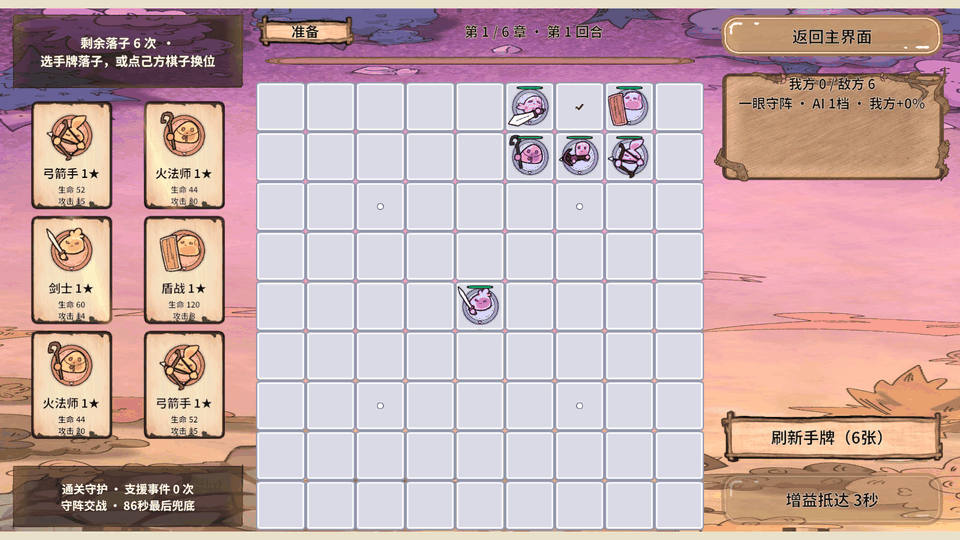
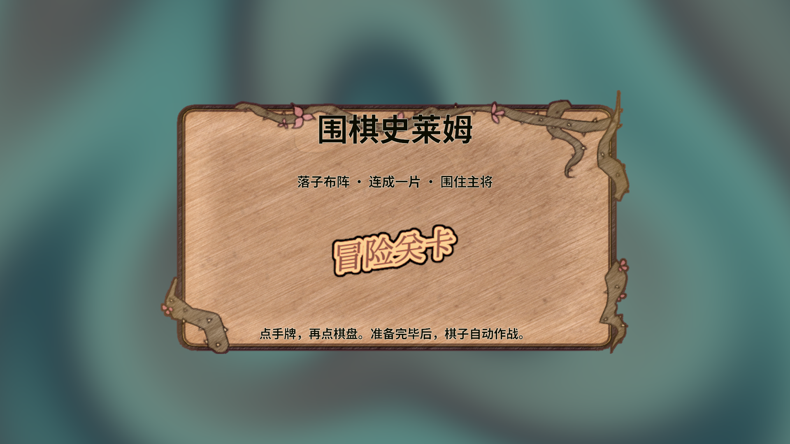
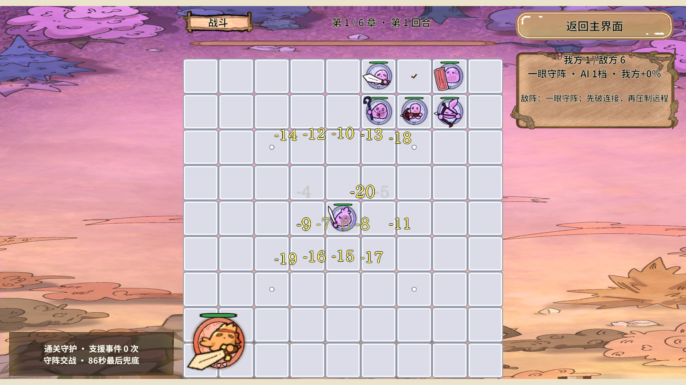

# RevGame 魔幻动态美术与弹幕增强验收

2026-10-18 · Unity 2022.3.15f1c1 · 实际 Play 画面 1920×1080 · 手机横屏、六张手牌

## 本次结果

已增加并缩小战斗飘字，提高真实攻击频率，补强弹道回收；手牌使用斜向流光 Shader，点击时通过 DOTween 轻压、倾斜和衰减抖动。木牌、羊皮纸底图增加低强度金色边缘呼吸，主界面和选关界面改用程序生成的流动星雾背景，场景背景则保留当前 Sprite 并施加轻微动态扭曲。

参考了[用户提供的 Balatro 游戏手感教程](https://www.bilibili.com/video/BV1WJ4m1E7Ct/)页面和视频预览。效果由本项目自行编写，没有导入视频作者的工程或复制其资源；这是适合现有美术的实现，不是视频画面的逐像素复刻。

## 弹幕数量、大小和攻击节奏

| 项目 | 本次设置 | 为什么这样做 |
|---|---|---|
| 攻击口号和伤害数字总数 | 同时最多20条，异步加载预约也占名额 | 密集输入实测峰值20条，避免加载完成后突然超标。 |
| 攻击口号 | 同时最多7条；全场间隔0.12秒、同棋间隔0.65秒 | 比旧版更频繁，但同一棋子不能占满屏幕。 |
| 同帧多棋口号 | 最多12条短队列，同棋最多一条待播，0.5秒过期 | 让齐射中的不同棋子错开显示，不再每次只让第一颗棋子显示口号。 |
| 伤害数字 | 同目标0.22秒合计，新数字间隔0.035秒 | 保留真实伤害总值，同时提高密集交火的反馈密度。 |
| 攻击口号大小 | 最大屏宽6%，基础缩放不超过0.72 | 短口号也会缩小，不会因为文字少而盖住整颗棋子。 |
| 数字大小 | 最大屏宽4%，基础缩放不超过0.82 | 数字变多后仍留出看棋子的空间。 |
| 避让 | 按真实文字包围盒尝试25个位置 | 将后续放大和上浮范围一起预留；无法完全避让时，下层文字35%透明。 |
| 活动弹道 | 最多14条；待播最多24条 | 使用原有RevPool实例，本体、轮廓和短尾一起复用。 |
| 真实攻击速度 | 双方在原有出手倍率上再提高35% | 改的是服务中的真实出手进度，不是假造弹道或重复造成伤害。 |

20条是上限和密集输入的实测峰值。场上没有足够攻击时，不凭空生成数字来凑数。文字基础文案、颜色、字号及其他演出参数继续读取既有 Excel 导表数据；本次没有手改生成表。

提高攻速时，将单发普通伤害按相同比例摊薄，尽量保持此前的总火力和长回合体验。普通90秒上限、围棋气眼、守阵、增益事件和后段通关支援仍然工作。整数伤害会有少量取整差异。

回归发现旧的“四舍五入时间后取模”移动判定会在攻速提高后重复放行。现在每颗敌棋记录最早下次移动时间，最多每五秒靠近一次；移动不再借用攻击进度，冷却也不会因本小步没有攻击额度而延后。敌棋有射界时继续攻击，不因提速乱跑，玩家仍保持原阵位。

低伤害棋子的Boss决死加速可能被整数取整抹掉，因此每满一分钟的加成至少增加1点单发伤害，使长期战斗中的加速真正生效。

## 子弹堆积和残留处理

单发自然结束在修改前能够正常回池，没有证据说明所有黄条都是永久未回收对象。已确认旧轨迹从棋子中心开始，所有距离都固定飞行0.36秒，尾巴又向发射源延伸，短距离连射容易看成黄条贴在棋子身上。本次同时处理飞行空间与生命周期：

1. 轨迹从发射者边缘开始，到受击者边缘结束；缩进距离随轨迹长度限制，不会越过终点。
2. 弹头长度不超过剩余飞行空间的80%，短尾缩短；相邻棋子之间不会塞入比间隙还长的条形弹头。
3. 飞行时间按距离计算，范围0.10～0.36秒；长距离仍保留大弹头，近距离及时结束。
4. 同格或极短距离直接结束，禁止生成没有位移的弹道。
5. 自然完成先关闭本体、轮廓和尾巴，再通知棋盘并归池；回池和停用也显式隐藏图层。
6. 额外记录寿命截止时间；外部误停或Kill了DOTween时，弹道仍会到期回收。寿命使用游戏时间，游戏正常暂停时一起暂停。
7. 切换阶段仍清数字、弹道和攻击口号队列，使旧异步回调失效，避免上一轮反馈进入新准备期。

Play 已验证零距离、0.2、1.15、8世界单位的自然结束，每次仅完成一次、回池后无可见图层；也验证了外部Kill Tween后仍能回收。池化检查另验证了弹道复用成文字时不残留子图，等待四秒后无旧回调，Tween数量回到基线。

## Shader、材质和新手阅读路径

| 文件（相对Unity工程） | 职责 |
|---|---|
| Assets/GameShader/Cards/CardGleam.shader | 卡面斜向宽高光和细亮边，金色中带少量青色，不改变透明边缘。 |
| Assets/GameShader/UI/ArcanePanel.shader | 底板边沿缓慢呼吸，保留木纹和羊皮纸，不给文字套动态滤镜。 |
| Assets/GameShader/Background/ArcaneBackdrop.shader | 程序星雾及背景原图轻微扭曲，使用同一Shader的两种材质参数。 |
| Assets/GameShader/Common/ArcaneUI.cginc | 共享顶点和片元代码、顶点颜色、UGUI模板遮罩与矩形裁剪。 |
| Assets/GameRes/Material/CardGleam.mat | 六张手牌共享，强度0.30、速度0.18。 |
| Assets/GameRes/Material/ArcanePanel.mat | 控件底图共享，强度0.12、速度0.22。 |
| Assets/GameRes/Material/ArcaneBackdrop.mat | UI无地图星雾，强度0.70、速度0.28，原图混合为0。 |
| Assets/GameRes/Material/ArcaneScene.mat | 场景背景动态，强度0.65、速度0.22，保留原图。 |
| Assets/GameScripts/UI/ArcaneImageCoordinates.cs | 保留UV0采样原图，UV1单独放特效坐标，避免九宫格与图集流光断裂。 |
| Assets/GameScripts/UI/CardItem.cs | 点击抖动与翻牌分别持有Tween；翻牌、关闭、切回合前取消旧反馈并复位。 |
| Assets/GameScripts/View/GamePresentation.cs | 经RevResManager两段式路径异步加载场景材质，销毁时配对释放；不覆盖用户选的背景Sprite。 |
| Assets/Editor/RevGame/GameArcaneArtBuilder.cs | 通过Unity MCP创建四个材质，保存35个UI底图引用；包含准备面板内的六个常驻卡槽。 |
| Assets/Editor/RevGame/GameArcanePresentationChecks.cs | Shader、六牌、UV、连点/翻牌和弹道寿命的真实Play验收与连续帧采集。 |

材质资源和预制体通过 Unity MCP 中的编辑器工具保存。没有修改 Revolution 框架快照，没有把编辑器代码放进 GameScripts/Editor，也没有保存覆盖用户当前场景。

给新手的最短阅读顺序：先看 `BoardView.OnDamage/OnAttack` 如何接收真实快照，再看 `BoardView.Feedback` 如何控制数量，最后看 `BattleEffectView` 如何播放和回池。卡片则从 `CardItem.OnClick` 看起：只做反馈并转发选牌，服务仍负责真正的手牌规则。

Shader中UV0是“去原图片的哪里取颜色”，UV1是“当前控件左下到右上的0～1位置”。把二者分开，拉伸九宫格不会把流光切成九块，图片进入图集也不会把光泽错采到别的卡牌上。六个槽位使用不同相位，但共享同一个材质。

## 本轮实际验证

| 验收 | 本轮结果与范围 |
|---|---|
| Unity C#编译 | 修复编译问题后控制台编译错误为0；后续Play正常进入。 |
| Shader | 三种Shader均通过实际编译，当前编辑器GPU支持；真实截图无粉色错误材质。 |
| 规则 | 645条真实业务断言通过，包含五秒内真实远程出手次数高于旧版八次。 |
| 布局 | 737条通过：五种尺寸、三类安全区、六牌与栏位边界。 |
| 战术 | 1280条通过；包含两组固定种子各连续66回合取胜，非任意输入的数学证明。 |
| 动态美术与寿命 | 37条Play断言通过：共享材质、UV隔离、连点抖动、刷新翻牌交接、自然/中断弹道回收。 |
| 密集反馈 | 49条Play断言通过；实际峰值20条飘字、14条弹道，含合并、避让、半透明、事件居中与切轮清理。 |
| 回合表现 | 136条Play断言通过：六牌、六槽复用、暂停动画清理、迟到回调和日志复位。 |
| 对象池 | 伤害/弹道/口号/升级/增益均启动、回池Kill、同实例复用，四秒后无旧回调且Tween数恢复。 |
| 视觉 | 1920×1080实际Play截图，30帧流光、点击与背景动态采集；GIF仅缩略展示。 |

本轮未执行 Android/iOS 真机、正式AB加载、GPU性能或内存峰值测量。Shader使用少量纹理采样和数学运算，不使用GrabPass、全屏模糊或额外RenderTexture；共享材质且不在Update中复制材质。这些设计减少额外开销，但不等同于已完成真机性能验收。

## 当前完成度和后续

本次请求涉及的飘字、攻速、弹道回收、UI背景替换、三类Shader、共享材质、卡片点击DOTween与中文注释已落地，并在编辑器真实流程中验证。整体项目仍是可玩原型与框架可行性验证，不能据此宣称商业完成。

框架验证方面，本轮继续证明：RevPool可复用多种战斗表现，RevResManager能加载共享动态材质，RevUI预制体支持材质与动画，业务生命周期能够清理异步表现；没有为此修改框架内核。

仍待后续：正式棋子与敌阵基础数值Excel、真机触控和GPU性能、AB资源打标与真加载验收、长期存档及完整商业音画制作。现有弹幕Excel接入不代表全部数值已表驱动。用户已有的场景拆分、背景导入、构建设置和生成路径文件改动继续保留，本次提交不夹带这些原有工作。
